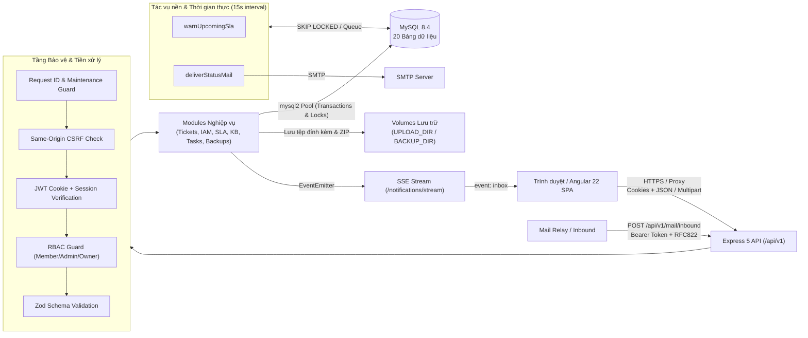

# Tổng quan & Bản đồ Dự án — Trạm Hỗ Trợ (Helpdesk System)

> **Phiên bản:** `0.2.0` · **Phạm vi tài liệu:** Mã nguồn và cấu hình hiện hành trong thư mục `local/` (nhánh `local`, repository `csn-dx24tt8016-toquangtuong-helpdesk-nodejs-local`).

---

## 1. Giới thiệu & Mục tiêu Hệ thống

**Trạm Hỗ Trợ** (*"Tiếp nhận hỗ trợ yêu cầu kỹ thuật"*) là hệ thống web quản lý yêu cầu hỗ trợ kỹ thuật (IT Helpdesk & Ticketing System) được xây dựng theo kiến trúc **SPA + REST API** tách biệt, sử dụng **Angular**, **Node.js (Express)** và **MySQL 8.4** (quản lý schema/migration qua **Prisma** và truy vấn runtime qua `mysql2`).

### Mục tiêu cốt lõi
1. **Tiếp nhận & Điều phối yêu cầu tập trung:** Chuẩn hóa quy trình tiếp nhận phiếu yêu cầu (Ticket) từ người dùng nội bộ/khách hàng (web form kèm tối đa 5 tệp/50 MB hoặc qua cổng Email-to-Ticket `POST /api/v1/mail/inbound`), tự động ước lượng mức ưu tiên (`LOW`, `MEDIUM`, `HIGH`, `URGENT`), cấp mã phiếu theo quy tắc cấu hình (`ticket_number_rules`) và tính toán hạn SLA theo giờ làm việc Việt Nam (`UTC+7`).
2. **Phân quyền & Quản trị Tổ chức (IAM/RBAC):** Hỗ trợ mô hình tổ chức đơn-tenant với 4 vai trò phân cấp (`OWNER`, `ADMIN`, `TECHNICIAN`, `USER`), cơ cấu đơn vị cây phân cấp (`organization_units`), quản lý hồ sơ nhân sự và luồng kích hoạt tài khoản dùng một lần (24 giờ).
3. **Trao đổi trực tiếp & Cơ sở tri thức (Live Chat & KB):** Tích hợp luồng trao đổi trực tiếp trong từng phiếu (kèm ghi chú nội bộ `is_internal` và cơ chế khóa chat sau 24 giờ kể từ khi `RESOLVED`/`CLOSED`), kết nối với Cơ sở tri thức (`knowledge_articles`) hỗ trợ tra cứu Self-Service (`PUBLIC`) và chèn nhanh liên kết bài viết vào câu trả lời (`1-Click Insert`).
4. **Theo dõi SLA, Thông báo thời gian thực & Sao lưu:** Cảnh báo sắp đến hạn SLA (trước 30 phút), đẩy thông báo qua **Server-Sent Events (SSE)** và hàng đợi email (`ticket_status_mail`), quản lý nhiệm vụ nhóm (`task_items`) và sao lưu/khôi phục toàn bộ dữ liệu nghiệp vụ dạng tệp `.zip`.

> **Lưu ý chế độ chạy:** Hệ thống hỗ trợ hai chế độ qua biến môi trường `DATA_SOURCE`: `mysql` (mặc định, đầy đủ xác thực, IAM/RBAC, SLA, KB, thông báo, sao lưu) và `demo` (dữ liệu mẫu trong bộ nhớ RAM để trình diễn nhanh).

---

## 2. Sơ đồ Cây Thư mục Dự án (`local/`)

```text
local/
├── .ai/                              # Quy tắc làm việc & chuẩn mã nguồn cho AI Agent
│   └── rules/
│       ├── working-rules.md          # Quy tắc phạm vi local/, nhánh Git, đồng bộ repo
│       └── source-code.md            # Quy ước kiến trúc Backend/Frontend & bảo mật
├── docker/                           # Cấu hình Docker Compose cho Dev & Production
│   ├── compose.yaml                  # Stack Dev (MySQL 8.4 + Express watch + Angular dev + watch)
│   ├── compose.prod.yaml             # Stack Prod (MySQL 8.4 + Express + Caddy HTTPS reverse proxy)
│   ├── backend.Dockerfile            # Image Node.js cho Express API & Prisma
│   ├── frontend.Dockerfile           # Multi-stage Dockerfile (dev server / Caddy static)
│   ├── Caddyfile                     # Reverse proxy /api/* và SPA fallback + nén (trừ SSE)
│   ├── .env.example / .env.production.example
│   ├── README.md                     # Hướng dẫn chạy Docker Dev
│   └── production.md                 # Hướng dẫn triển khai Production HTTPS
├── docs/                             # Bộ tài liệu kỹ thuật chuẩn (tài liệu hiện tại)
│   ├── overview/                     # Tổng quan, bản đồ dự án, tech stack
│   ├── specs/                        # Đặc tả chức năng (SRS) & luồng người dùng (User Flows)
│   ├── system-design/                # Kiến trúc hệ thống, thiết kế CSDL & đặc tả API
│   └── guidelines/                   # Quy chuẩn mã nguồn & ma trận phân quyền RBAC
├── documents/                        # Tài liệu đồ án, bản thảo kế hoạch & thiết kế UI gốc
│   ├── diagrams/                     # Sơ đồ Use-case, Activity (.drawio, .png)
│   ├── markdown/                     # Các bản kế hoạch kỹ thuật (IAM/RBAC, SLA, Đa kênh, API/DB demo)
│   ├── Phase-1-Design-UI/            # Design System, UX/UI Kit & quy định linh vật Mèo
│   ├── docx/, pdf/, xlsx/            # Biểu mẫu báo cáo, rubric, kế hoạch đề tài
├── output/playwright/                # Bộ kiểm thử E2E Playwright & log chạy thử
├── progress-report/                  # Báo cáo tiến độ theo mốc ngày
├── setup/
│   └── docker.mjs                    # Script điều phối `pnpm dev`, `build`, `check`, `stop`
├── src/
│   ├── README.md                     # Hướng dẫn kỹ thuật & kiểm thử chi tiết
│   ├── backend/                      # Express 5 REST API (ESM)
│   │   ├── prisma/                   # schema.prisma, seed.js & 9 thư mục migrations/
│   │   ├── scripts/                  # check-syntax, clean-cache, docker-init-db, seed-review-data...
│   │   ├── sql/                      # SQL thuần tham chiếu (helpdesk-schema.sql, sample-data...)
│   │   ├── test/                     # Unit & Integration test (`node --test`)
│   │   └── src/
│   │       ├── app.js                # Khai báo middleware toàn cục & mount tất cả routes `/api/v1`
│   │       ├── server.js             # Khởi động HTTP server & background jobs (SLA, Mail)
│   │       ├── configs/env.js        # Đọc và chuẩn hóa biến môi trường
│   │       ├── database/pool.js      # Kết nối MySQL2 Pool
│   │       ├── middlewares/          # error.js (AppError -> JSON), validate.js (Zod)
│   │       ├── shared/               # errors.js, async-resource.routes.js, archive.js, batch-state.js
│   │       └── modules/              # Các module nghiệp vụ tách biệt
│   │           ├── accounts/         # Hồ sơ cá nhân (profile.routes.js) & danh bạ/chuyên môn (accounts.routes.js)
│   │           ├── auth/             # Đăng ký, kích hoạt, đăng nhập JWT/Cookie, refresh rotation
│   │           ├── backups/          # Tạo ZIP, tải về, lịch tự động, khôi phục & maintenance lock
│   │           ├── categories/       # Danh mục dịch vụ cha-con (Route -> Controller -> Service -> Repo)
│   │           ├── knowledge/        # Cơ sở tri thức (PUBLIC/INTERNAL, Fulltext search)
│   │           ├── notifications/    # SSE stream, Inbox, SLA warnings job, Outgoing & Inbound mail
│   │           ├── organizations/    # Tổ chức, nhân sự, cây đơn vị, phân quyền RBAC, token kích hoạt
│   │           ├── sla/              # Chính sách SLA, lịch làm việc tuần/ngày lễ, tính hạn UTC+7
│   │           ├── tasks/            # Nhiệm vụ nhóm (TODO/DOING/DONE, optimistic lock)
│   │           ├── tickets/          # Yêu cầu hỗ trợ, state machine, comment/chat, đính kèm, đánh số, batch
│   │           └── users/            # Dữ liệu/schema người dùng cho chế độ demo
│   └── frontend/                     # Angular 22 Standalone SPA (Signals + Vite + Vitest)
│       ├── public/                   # Fonts (Chivo), favicon & bộ minh họa mascot Trạm Hỗ Trợ
│       └── src/app/
│           ├── app.config.ts         # Router, HttpClient + interceptor renewSession, I18n
│           ├── app.routes.ts         # Định tuyến bảo vệ bằng `requireSession` & role `data.access`
│           ├── core/                 # auth/session.ts, http/ (api-response, network-progress), i18n/, preferences/
│           ├── layout/               # Khung giao diện chính (shell.ts / shell.html)
│           ├── shared/               # data/ (workspace.service, iam, types, labels), date/, ui/ (loading, row-menu, batch)
│           └── features/             # Các phân hệ màn hình theo tính năng
│               ├── auth/             # Login & Onboarding (register, activate, pending-assignment)
│               ├── backups/          # Quản lý sao lưu, khôi phục & lịch tự động
│               ├── categories/       # Quản lý loại phiếu & danh mục dịch vụ
│               ├── directory/        # Danh mục chung (nhân sự + loại phiếu)
│               ├── knowledge/        # Cổng tra cứu KB & KnowledgeLinks (gợi ý / picker)
│               ├── notifications/    # Chuông thông báo SSE & trang Hộp thư thông báo
│               ├── organization/     # Cơ cấu tổ chức (cây đơn vị, sơ đồ liên kết) & Nhân sự
│               ├── overview/         # Dashboard Admin/Owner, RoleDashboard (Tech/User), Reports
│               ├── profile/          # Hồ sơ cá nhân, đổi mật khẩu, ảnh đại diện
│               ├── settings/         # Cài đặt chung, Quy tắc đánh số phiếu, Cài đặt SLA
│               ├── tasks/            # Nhiệm vụ nhóm (Bảng Kanban, Lịch tháng/tuần, Danh sách)
│               └── workspace/        # Quản lý Ticket, QuickTicket modal, BulkActions, Live Chat
└── package.json                      # Workspace scripts (`pnpm dev`, `build`, `check`, `stop`)
```

---

## 3. Vai trò Từng Module Chính

| Module / Thư mục | Trách nhiệm chính |
| :--- | :--- |
| **`auth`** | Xác thực stateless/stateful kết hợp: Access JWT (`15m`) + Refresh Token (`64 hex` băm SHA-256 lưu bảng `auth_sessions` với cơ chế rotate), cookie `HttpOnly` + `SameSite=Strict`, kiểm tra `Origin` chống CSRF, giới hạn tần suất (`checkRate`), tự đăng ký (`UNASSIGNED`) và kích hoạt tài khoản. |
| **`organizations`** | Quản lý thông tin tổ chức (`organizations`), cây đơn vị trực thuộc (`organization_units` hỗ trợ phát hiện chu trình và xóa mềm), quản lý nhân sự (`organization_members`), cấp lại liên kết kích hoạt, khóa/mở khóa hàng loạt và tập trung hàm phân quyền (`isOwner`, `isAdmin`, `isTechnician`, `canManage`). |
| **`accounts`** | API hồ sơ cá nhân (`/api/v1/profile`) lưu JSON chi tiết + ảnh đại diện BLOB (`user_profiles`), danh bạ thu gọn cho người dùng/kỹ thuật viên (`/api/v1/directory`) và gán chuyên môn kỹ thuật viên (`technician_categories`). |
| **`categories`** | Quản lý danh mục dịch vụ phân cấp cha–con (`categories.parent_id`), hỗ trợ bật/tắt hàng loạt (`batch-state`) mà không làm đứt liên kết phiếu cũ. |
| **`tickets`** | Trung tâm xử lý yêu cầu: CRUD phiếu, đính kèm tệp (`multer` + kiểm tra magic bytes), cấp mã phiếu tuần tự có khóa (`ticket_number_rules`), tự động ước lượng độ ưu tiên (`priority-rules.json`), máy trạng thái (`NEW` → `IN_PROGRESS` ↔ `PENDING_CUSTOMER` → `RESOLVED` → `CLOSED`), trao đổi/chat khóa sau 24h, thao tác hàng loạt (đổi người phụ trách, gộp phiếu) và xóa mềm (`archived_at`). |
| **`sla`** | Cấu hình lịch làm việc tuần (`week`), ngày nghỉ lễ (`holidays`) và mục tiêu phản hồi/xử lý theo cặp `(customerTier, priority)`. Tính hạn SLA bằng phút làm việc thực tế theo múi giờ Việt Nam (`UTC+7`) và lưu kết quả bằng `UTC`. |
| **`knowledge`** | Kho bài viết hướng dẫn (`PUBLIC` cho cổng Self-Service, `INTERNAL` cho nội bộ nhân viên). Hỗ trợ tìm kiếm MySQL Fulltext kết hợp `LOCATE`, phân trang keyset (`before`) và chặn chèn link bài viết `INTERNAL` vào bình luận công khai. |
| **`notifications`** | Kênh thông báo đa luồng: SSE (`/api/v1/notifications/stream`) đẩy sự kiện làm mới hộp thư, tác vụ nền quét cảnh báo sắp đến hạn SLA (`warnUpcomingSla` mỗi 15s), hàng đợi gửi email trạng thái (`deliverStatusMail` qua `nodemailer`) và nhận email tạo phiếu (`POST /api/v1/mail/inbound` qua `mailparser`). |
| **`tasks`** | Quản lý công việc nội bộ của đội ngũ kỹ thuật/quản trị (`TODO`, `DOING`, `DONE`) với khóa lạc quan (`version`) và phân quyền sửa theo người tạo/người phụ trách/Admin. |
| **`backups`** | Tạo bản sao lưu `.zip` (`yazl`) chứa JSON toàn bộ dữ liệu nghiệp vụ + tệp đính kèm vật lý, lập lịch tự động từ phía phiên Owner, tải về và khôi phục an toàn (tạo bản dự phòng trước khi ghi đè và bật khóa ghi tạm thời qua `maintenance.js`). |

---

## 4. Luồng Dữ liệu Tổng thể (High-level Data Flow)


