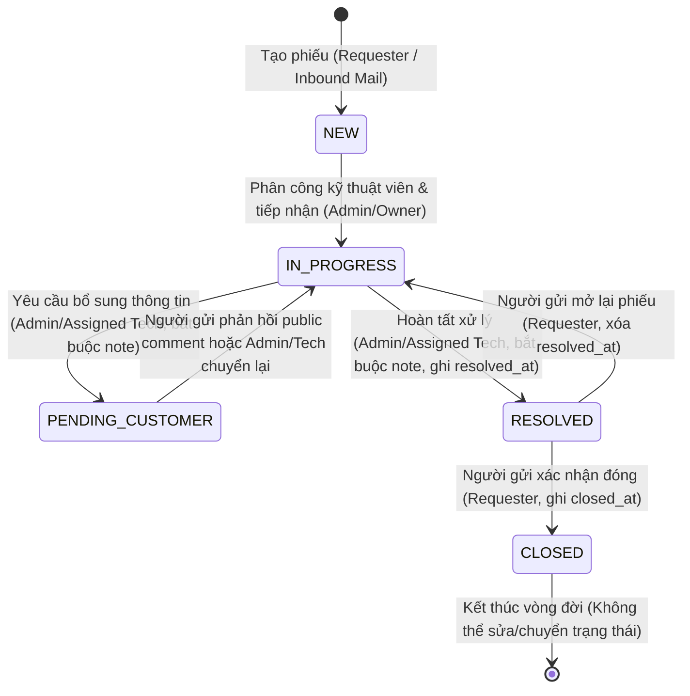

# Đặc tả Yêu cầu & Nghiệp vụ Chức năng (SRS) — Trạm Mèo

> **Nguồn đối chiếu thực tế:** `local/src/backend/src/modules/*`, `local/src/backend/prisma/schema.prisma`, `local/src/frontend/src/app/features/*`.
> Các hạng mục có trong kế hoạch thiết kế (`local/documents/markdown/`) nhưng chưa triển khai trong mã nguồn được đánh dấu rõ **`[Draft / Planned]`**.

---

## 1. Quản lý Tổ chức & Phân quyền (IAM / RBAC)

### 1.1. Mô hình Tổ chức & Vai trò
Hệ thống vận hành theo mô hình **một tổ chức (`organizations`) trên mỗi bản cài đặt** (đơn-tenant), sử dụng 4 vai trò phân cấp lưu trong `organization_members.role` (enum `MemberRole`):

| Thứ bậc (`rank`) | Mã vai trò | Tên tiếng Việt | Phạm vi quyền hạn thực tế trong mã nguồn |
| :---: | :--- | :--- | :--- |
| `0` | **`OWNER`** | Chủ sở hữu | Toàn quyền hệ thống: sửa thông tin tổ chức (`PUT /api/v1/organizations`), quản lý cây đơn vị (`organization_units`), cấu hình quy tắc đánh số phiếu, sao lưu & khôi phục dữ liệu (`/api/v1/backups`), quản lý `ADMIN`, `TECHNICIAN`, `USER`. |
| `1` | **`ADMIN`** | Quản trị viên | Quản lý nhân sự cấp dưới (`TECHNICIAN`, `USER`), danh mục dịch vụ, chuyên môn kỹ thuật viên, cấu hình SLA, kho tri thức KB, nhiệm vụ nhóm, xem/điều phối/gộp/lưu trữ toàn bộ ticket. Không được sửa tổ chức, không được tạo/sửa `OWNER` hoặc `ADMIN` khác. |
| `2` | **`TECHNICIAN`** | Chuyên viên kỹ thuật | Xem và xử lý các ticket được phân công (`assignee_id = account.id`) hoặc ticket do chính mình gửi (`requester_id = account.id`); tham gia nhiệm vụ nhóm (`/api/v1/tasks`); xem bài viết KB nội bộ (`INTERNAL`). Không có quyền phân công ticket cho người khác hoặc đổi danh mục. |
| `3` | **`USER`** | Người dùng | Gửi ticket mới, theo dõi/bình luận công khai trên ticket của mình, xác nhận đóng (`CLOSED`) hoặc mở lại (`IN_PROGRESS`) khi ticket đang `RESOLVED`, tra cứu cổng KB công khai (`PUBLIC`) và quản lý hồ sơ cá nhân. |

> **Quy tắc phân cấp `canManage(actor, targetRole)`** (`permissions.js`): Chỉ `OWNER` hoặc `ADMIN` đang `ACTIVE` mới có quyền quản lý thành viên, và chỉ thao tác được với vai trò có `rank` thấp hơn (`rank.get(actor.role) < rank.get(targetRole)`). Mọi nhân sự (kể cả `ADMIN`, `TECHNICIAN`) đều mang quyền `USER` cơ bản trong `roleCodes` để gửi yêu cầu cho chính mình.

### 1.2. Cơ cấu Đơn vị Trực thuộc (`organization_units`)
* **Cây phân cấp:** Mỗi đơn vị có `parent_id` trỏ tới đơn vị cha trong cùng `organization_id` (hỗ trợ xem dạng bảng cây, sơ đồ liên kết và danh sách).
* **Kiểm tra toàn vẹn (`units.routes.js`):**
  * Chống trùng mã `code` (`UNIT_CODE_DUPLICATE` - 409) trong cùng tổ chức.
  * Chống gán `parentId` trỏ tới đơn vị đã xóa hoặc không hoạt động (`UNIT_UNAVAILABLE` - 422).
  * Chống tạo chu trình cây cha–con (`UNIT_CYCLE` - 422).
* **Xóa mềm:** Chỉ `OWNER` được xóa mềm (`deleted_at = UTC_TIMESTAMP(3), is_active = 0`) khi đơn vị không còn nhân sự (`organization_members.unit_id`) và không còn đơn vị con đang hoạt động (`UNIT_IN_USE` - 409).
* **`[Draft / Planned]` Phân quyền & hàng đợi theo phòng ban:** Hiện `unit_id` đã lưu và hiển thị trên hồ sơ nhân sự; việc định tuyến ticket và giới hạn quyền xem ticket theo đơn vị/phòng ban thuộc giai đoạn tiếp theo (theo `README.local.md` & `ke-hoach-iam-rbac.md`).

---

## 2. Quản lý Hồ sơ Nhân sự & Luồng Kích hoạt Tài khoản (Onboarding Flow)

### 2.1. Quản lý Nhân sự (`organization_members`)
* **Trạng thái tài khoản (tính động trong `members.repository.js`):**
  * `DISABLED`: `users.is_active = 0`
  * `PENDING_ACTIVATION`: `users.is_active = 1` và `users.password_hash IS NULL`
  * `ACTIVE`: `users.is_active = 1` và `users.password_hash IS NOT NULL`
* **Thông tin nhân sự:** `fullName`, `email`, `phone`, `employeeCode` (duy nhất trong tổ chức), `unitId` / `department`, `position`, `customerTier` (`STANDARD` | `VIP` — dùng để áp dụng hạn mức SLA), `role`.
* **Thao tác hàng loạt & Thu hồi phiên:** `PATCH /api/v1/users/batch-state` cho phép khóa/mở khóa nhiều nhân sự cấp dưới cùng lúc. Khi khóa tài khoản hoặc thay đổi vai trò, backend tự động thu hồi toàn bộ `auth_sessions` đang hoạt động của tài khoản đó (`revoked_at = UTC_TIMESTAMP(3)`).

### 2.2. Luồng Kích hoạt & Tự đăng ký (Onboarding)
Hệ thống hỗ trợ 2 con đường đưa người dùng vào tổ chức:
1. **Người dùng tự đăng ký (`/register` → `POST /api/v1/auth/register`):**
   * Yêu cầu mật khẩu mới tối thiểu **12 ký tự**, tối đa **72 byte** (`newPassword` trong `auth.routes.js`), băm `bcryptjs` cost `12`.
   * Tài khoản được tạo trong `users` nhưng chưa có bản ghi trong `organization_members` → khi đăng nhập nhận `status: 'UNASSIGNED'` và bị guard `requireSession` điều hướng tới `/pending-assignment` (*Chờ cấp quyền truy cập*).
   * Khi `OWNER`/`ADMIN` thêm nhân sự với email đã tự đăng ký, hệ thống liên kết tài khoản đó vào `organization_members`, cập nhật thông tin và thu hồi phiên cũ để người dùng đăng nhập lại vào không gian mới.
2. **Quản trị viên tạo nhân sự mới (`/users/new` → `POST /api/v1/users`):**
   * Tạo bản ghi `users` với `password_hash = NULL` và sinh token ngẫu nhiên `32 bytes` hex (`64` ký tự), lưu `SHA-256(token)` vào `activation_token_hash` với hạn **24 giờ** (`activation_expires_at`).
   * Trả về đường dẫn `/activate#token=<token>` để quản trị viên sao chép gửi riêng cho nhân sự (có thể cấp lại qua `POST /api/v1/users/:id/invitation`).
   * Nhân sự truy cập `/activate`, đặt mật khẩu (≥ 12 ký tự) → `POST /api/v1/auth/activate` xác thực token còn hạn, đặt `password_hash` và xóa trắng token (dùng một lần).

### 2.3. Hồ sơ Cá nhân (`/profile`)
* Lưu thông tin mở rộng dạng JSON trong `user_profiles.details` (`department`, `jobTitle`, `location`, `birthDate`, `bio`) cùng `fullName`, `phone` (email ở chế độ chỉ đọc đối với tự sửa).
* Hỗ trợ tải lên/tải về ảnh đại diện (`PNG`, `JPEG`, `WebP`, tối đa **2 MB**, kiểm tra magic bytes trong `profile.routes.js`), lưu `MEDIUMBLOB` trong `user_profiles.avatar`.

---

## 3. Quy trình Xử lý Ticket (Ticket Workflow)

### 3.1. Tạo Ticket, Đánh số, Ưu tiên & SLA
* **Kênh tiếp nhận:**
  1. **Web Portal (`POST /api/v1/tickets`):** Hỗ trợ JSON hoặc `multipart/form-data` kèm tối đa **5 tệp**, tổng dung lượng tối đa **50 MB** (chỉ cho phép `PNG`, `JPEG`, `GIF`, `WebP`, `PDF` qua kiểm tra magic bytes ở `attachments.js`).
  2. **Email-to-Ticket (`POST /api/v1/mail/inbound`):** Nhận email thô `message/rfc822` (tối đa `256kb`) từ relay có `Authorization: Bearer <INBOUND_MAIL_TOKEN>` và header `X-Verified-Sender`; chống trùng lặp bằng `inbound_ticket_mail.fingerprint`.
* **Quy tắc đánh số phiếu (`ticket_number_rules`):**
  * Form tạo phiếu gọi `GET /api/v1/tickets/number-preview?categoryId=...` để xem trước mã dự kiến.
  * Khi lưu vào MySQL, `allocateMysqlCode` khóa dòng mặc định `category_id = 0` (`FOR UPDATE`), ưu tiên quy tắc riêng của `categoryId` (gồm `prefix`, `next_number`, `digits`, `suffix`), tìm mã chưa tồn tại và tăng `next_number`.
* **Ước lượng độ ưu tiên tự động (`priority.js`):** Chuẩn hóa tiếng Việt (bỏ dấu, lowercase) tiêu đề + mô tả và đối chiếu với `priority-rules.json` (`URGENT` → `HIGH` → `LOW`, mặc định `MEDIUM`). Admin hoặc Technician phụ trách có thể sửa lại khi phiếu chưa đóng.
* **Tính hạn SLA (`sla/policy.js`):** Nếu tổ chức bật SLA (`policy.enabled = true`), hệ thống lấy cặp `(customerTier, priority)` và tính `response_due_at`, `resolution_due_at` theo lịch làm việc từng ngày trong tuần + danh sách ngày lễ (`holidays`) ở múi giờ Việt Nam (`UTC+7`), lưu bằng `UTC`.

### 3.2. Máy Trạng thái Ticket (State Machine)
Định nghĩa trong `local/src/backend/src/modules/tickets/ticket-status.js`:

* **Ràng buộc chuyển trạng thái (`ticket-access.js` & `mysql.repository.js`):**
  * Mọi cập nhật đều yêu cầu **khóa lạc quan (`version`)**; sai `version` hoặc chuyển trạng thái không hợp lệ trả về `409 CONFLICT`.
  * Nếu trạng thái đích khác `NEW`, bắt buộc `assigneeId !== null` (`INVALID_ASSIGNEE` - 422).
  * Chuyển sang `PENDING_CUSTOMER` hoặc `RESOLVED` **bắt buộc có `note`** (`NOTE_REQUIRED` - 422).
  * Khi đang ở `RESOLVED`, chỉ **người gửi (`requesterId`)** mới có quyền chuyển sang `CLOSED` hoặc mở lại `IN_PROGRESS`.

### 3.3. Phân công, Xem nhanh (Quick View) & Thao tác Hàng loạt
* **Phân công thủ công & Gợi ý kỹ thuật viên:**
  * `GET /api/v1/tickets/technicians?categoryId=...` trả về danh sách kỹ thuật viên `ACTIVE` có chuyên môn phù hợp (truy vấn đệ quy lên danh mục cha), sắp xếp ưu tiên: **(1)** khớp đúng `categoryId`, **(2)** ít ticket đang mở (`NOT IN ('RESOLVED', 'CLOSED')`) nhất, **(3)** theo tên.
  * Admin/Owner phân công qua `PUT /api/v1/tickets/:id/assignee` hoặc `PUT /api/v1/tickets/:id/classification` (đổi cả danh mục + kỹ thuật viên).
  * **`[Draft / Planned]` Tự động phân công (Auto-Assignment):** Hệ thống hiện chưa tự gán `assignee_id` lúc tạo phiếu (luôn khởi tạo `assignee_id = NULL`); việc tự động gán theo vòng tròn/tải ít nhất là hướng mở rộng tiếp theo.
* **Xem nhanh (`QuickTicket` modal):** Component `quick-ticket.ts` cho phép mở hộp thoại modal xem chi tiết phiếu, lịch sử 6 sự kiện gần nhất (`GET /api/v1/tickets/:id/history`) và thực hiện thao tác nhanh (`TicketActions`) mà không rời trang danh sách.
* **Thao tác hàng loạt (`POST /api/v1/tickets/batch` & `POST /api/v1/tickets/archive`):**
  * **Đổi người phụ trách hàng loạt:** Chọn ≥ 2 phiếu cùng `categoryId`, chưa `CLOSED`, gửi kèm `{ id, version }` và `assigneeId`.
  * **Gộp phiếu (Merge):** Chọn ≥ 2 phiếu cùng `categoryId` và cùng `requesterId`, chọn 1 phiếu đích (`targetId`) chưa `CLOSED`. Các phiếu nguồn bị đánh dấu `archived_at` và ghi sự kiện `MERGED_INTO` / `MERGED_TICKET`.
  * **Xóa mềm (Archive):** Chỉ `ADMIN`/`OWNER` được lưu trữ phiếu (`archived_at = UTC_TIMESTAMP(3)`).

---

## 4. Kênh Chat Hỗ trợ Trực tiếp (Live Chat Session)

* **Bản chất triển khai (`comments.js` & `workspace.ts`):** Kênh trao đổi nằm trực tiếp trong màn hình chi tiết/sửa phiếu, sử dụng bảng `ticket_comments` và cơ chế đồng bộ qua thông báo SSE + tải lại danh sách bình luận (`GET /api/v1/tickets/:ticketId/comments`).
* **Bình luận công khai vs Ghi chú nội bộ (`is_internal`):**
  * `is_internal = false`: Hiển thị cho cả người gửi, chuyên viên phụ trách và Admin/Owner.
  * `is_internal = true`: Chỉ `ADMIN`, `OWNER` và `TECHNICIAN` đang phụ trách (`assignee_id`) mới được tạo và xem; người gửi (`USER`) bị lọc bỏ ở tầng SQL.
* **Tự động cập nhật nghiệp vụ khi chat:**
  * Khi nhân sự hỗ trợ (`canHandle`) gửi bình luận công khai đầu tiên, backend tự động ghi `tickets.first_response_at` (làm mốc đo SLA phản hồi).
  * Khi phiếu đang ở `PENDING_CUSTOMER` và người gửi (`requesterId`) gửi bình luận công khai, hệ thống tự động chuyển trạng thái phiếu về `IN_PROGRESS`, tăng `version`, ghi `ticket_events` và đẩy thông báo/email.
* **Cơ chế khóa phiên chat sau 24 giờ (`chat-session.js`):**
  * `chatExpiresAt(ticket)` = `(ticket.closedAt ?? (ticket.status === 'RESOLVED' ? ticket.resolvedAt : null)) + 86,400,000 ms` (24 giờ).
  * Khi quá hạn (`expiresAt <= Date.now()`) hoặc phiếu đã bị gộp (`mergedInto`), giao diện khóa ô nhập liệu (`chatLocked`) và backend từ chối tạo bình luận mới với mã lỗi `409 CHAT_EXPIRED`.

---

## 5. Cơ sở Tri thức (Knowledge Base)

* **Phân loại hiển thị (`knowledge_articles.visibility`):**
  * `PUBLIC`: Công khai trên cổng **Self-Service Portal** (`/knowledge`, `/knowledge/:id`), cho phép truy cập không cần đăng nhập.
  * `INTERNAL`: Chỉ hiển thị và cho phép tìm kiếm đối với tài khoản `ACTIVE` có vai trò `OWNER`, `ADMIN`, `TECHNICIAN`.
* **Tìm kiếm (`knowledge/routes.js`):** Kết hợp `MATCH(a.title, a.body) AGAINST (? IN NATURAL LANGUAGE MODE)` của MySQL với fallback `LOCATE` theo từng từ khóa (tối đa 8 token), lọc theo `categoryId` và phân trang keyset (`before`).
* **Gợi ý tự động & Chèn nhanh 1-Click (`KnowledgeLinks` trong `knowledge-links.ts` & `workspace.ts`):**
  * **Gợi ý lúc tạo phiếu (`mode="suggestions"`):** Khi người dùng nhập tiêu đề phiếu (≥ 3 ký tự), hệ thống tự động gợi ý tối đa 5 bài viết `PUBLIC` liên quan để người dùng tự xử lý trước khi gửi phiếu.
  * **1-Click Insert trong Live Chat (`mode="picker"`):** Chuyên viên/Admin tìm kiếm bài viết KB (bao gồm cả `PUBLIC` và `INTERNAL` tùy ngữ cảnh) và bấm 1 lần vào tên bài viết để chèn chuỗi `<Tiêu đề> /knowledge/<id>` vào ô nhập bình luận.
  * **Bảo vệ chống rò rỉ tài liệu nội bộ:** Khi gửi bình luận công khai (`internal = false`), backend quét các đường dẫn `/knowledge/:id` trong nội dung; nếu có bài viết `visibility = 'INTERNAL'`, hệ thống chặn ngay với lỗi `422 KB_INTERNAL_LINK`.

---

## 6. Các Phân hệ Hỗ trợ Khác Đã Triển khai

* **Quản lý Danh mục Dịch vụ (`categories`):** Cây danh mục cha–con (`parent_id`), bật/tắt hàng loạt (`PATCH /api/v1/categories/batch-state`), giữ toàn vẹn liên kết với các phiếu cũ khi ngưng sử dụng.
* **Nhiệm vụ Nhóm (`tasks`):** Quản lý công việc nội bộ (`TODO`, `DOING`, `DONE`) dành cho `ADMIN`/`OWNER`/`TECHNICIAN` với 3 góc nhìn trên Frontend (Kanban kéo-thả, Lịch tháng/tuần, Danh sách) và khóa lạc quan `version`.
* **Thông báo Thời gian thực & Đa kênh (`notifications`):**
  * SSE (`GET /api/v1/notifications/stream`, tối đa 8 kết nối/tài khoản, heartbeat 25s) kích hoạt làm mới chuông thông báo và toast trên giao diện.
  * Tác vụ nền `warnUpcomingSla` (chạy mỗi 15s) cảnh báo trước 30 phút khi sắp quá hạn phản hồi hoặc xử lý.
  * Tác vụ nền `deliverStatusMail` (chạy mỗi 15s) gửi email từ bảng hàng đợi `ticket_status_mail` qua `nodemailer` (hỗ trợ retry).
* **Sao lưu & Khôi phục (`backups`):** Dành riêng cho `OWNER`. Tạo gói `.zip` (`data.json` + toàn bộ tệp trong `UPLOAD_DIR`), hỗ trợ lập lịch tự động phía client (`30`, `60`, `180`, `360`, `1440` phút), tải về và khôi phục (tự động tạo bản dự phòng trước khi ghi đè, bật chế độ bảo trì khóa API ghi trong lúc xử lý).
