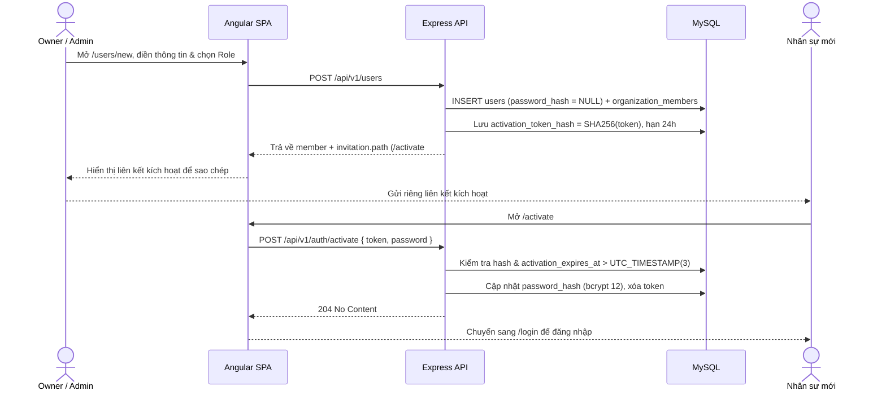
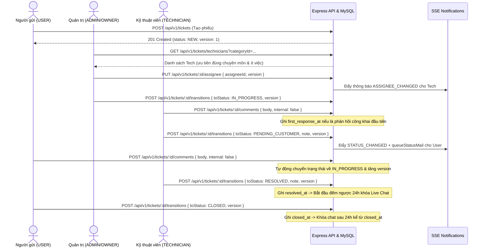

# Luồng Thao tác Người dùng (User Flows) — Trạm Mèo

> Tài liệu mô tả các luồng tương tác đầu–cuối (End-to-End) theo từng vai trò dựa trên mã nguồn `local/src/frontend` và `local/src/backend`.

---

## 1. Luồng Xác thực & Kích hoạt Tài khoản (Onboarding Flow)

### 1.1. Người dùng mới tự đăng ký & được cấp quyền
1. Người dùng truy cập `/register`, nhập `fullName`, `email`, `password` (≥ 12 ký tự).
2. Frontend gửi `POST /api/v1/auth/register`. Backend tạo bản ghi trong `users` (chưa có trong `organization_members`).
3. Người dùng đăng nhập tại `/login` (`POST /api/v1/auth/login`). Backend trả về `status: 'UNASSIGNED'`.
4. Guard `requireSession` nhận thấy `organizationId === null` nên điều hướng sang `/pending-assignment` (*Chờ cấp quyền truy cập*).
5. `OWNER` hoặc `ADMIN` vào **Nhân sự → Thêm nhân sự**, nhập đúng email đó kèm `role`, `unitId`, `customerTier`. Backend liên kết user vào `organization_members` và thu hồi phiên cũ.
6. Người dùng đăng nhập lại → `status: 'ACTIVE'` → được điều hướng vào không gian tương ứng (`/` cho Admin/Owner, `/dashboard/technician` cho Technician, `/dashboard/user` cho User).

### 1.2. Quản trị viên tạo nhân sự & kích hoạt qua liên kết 24 giờ

---

## 2. Luồng Tạo Yêu cầu, Tự phục vụ KB & Xử lý Ticket

### 2.1. Người dùng (`USER`) tạo phiếu & theo dõi
1. Tại `/tickets/new`, người dùng nhập tiêu đề phiếu (≥ 3 ký tự) → component `KnowledgeLinks` (`mode="suggestions"`) tự động gọi `GET /api/v1/knowledge?q=...&publicOnly=true` hiển thị tối đa 5 bài viết `PUBLIC` liên quan.
2. Nếu chưa giải quyết được, người dùng chọn danh mục (`categoryId`). Frontend gọi `GET /api/v1/tickets/number-preview?categoryId=...` hiển thị mã phiếu dự kiến.
3. Người dùng đính kèm tối đa 5 tệp (tổng ≤ 50 MB) và bấm gửi (`POST /api/v1/tickets`).
4. Backend cấp mã chính thức (`allocateMysqlCode`), ước lượng `priority`, tính `responseDueAt` & `resolutionDueAt` theo SLA (nếu bật), lưu tệp và tạo phiếu ở trạng thái `NEW`.

### 2.2. Vòng đời xử lý Ticket giữa `ADMIN`, `TECHNICIAN` và `USER`

---

## 3. Luồng Live Chat & Chèn nhanh Cơ sở Tri thức (1-Click Insert)

1. Khi mở chi tiết/sửa phiếu (`/tickets/:id/edit` hoặc `/tickets/:id/view`), frontend gọi `GET /api/v1/tickets/:ticketId/comments` để lấy danh sách trao đổi và `meta.chatExpiresAt`.
2. Trên giao diện hỗ trợ, nhân viên (`ADMIN`/`OWNER`/`TECHNICIAN`) có thể:
   * Bật/tắt tùy chọn **Ghi chú nội bộ** (`internal: true`) — chỉ hiển thị cho nội bộ nhân sự xử lý phiếu.
   * Dùng khung tìm kiếm `KnowledgeLinks` (`mode="picker"`) để tra cứu bài viết `PUBLIC` hoặc `INTERNAL` và bấm **1-Click** vào tiêu đề bài viết để tự động chèn `<Tiêu đề> /knowledge/<id>` vào ô nhập chat.
3. Khi gửi (`POST /api/v1/tickets/:ticketId/comments`):
   * Nếu `internal: false` và nội dung chứa link tới bài viết `INTERNAL`, backend chặn với `422 KB_INTERNAL_LINK`.
   * Nếu thời điểm hiện tại vượt quá `chatExpiresAt` (24 giờ sau `resolvedAt` hoặc `closedAt`), frontend khóa ô nhập liệu (`chatLocked`) và backend trả về `409 CHAT_EXPIRED`.

---

## 4. Luồng Quản trị Hệ thống (`OWNER` & `ADMIN`)

### 4.1. Cấu hình Tổ chức, SLA & Quy tắc đánh số (`OWNER` / `ADMIN`)
1. **Cơ cấu tổ chức (`/settings/organizations`):** `OWNER` xem/cập nhật thông tin tổ chức, tạo/sửa/xóa mềm đơn vị trên cây `organization_units`; `ADMIN` quản lý danh sách nhân sự tại `/users`.
2. **Danh mục & Chuyên môn (`/categories`, `/users/:id/edit`):** `ADMIN` tạo cây danh mục dịch vụ cha–con, bật/tắt hàng loạt loại phiếu và gán danh mục chuyên môn cho từng `TECHNICIAN` (`PUT /api/v1/users/:id/categories`).
3. **Quy tắc đánh số phiếu (`/settings`):** `OWNER` chỉnh `prefix`, `nextNumber`, `digits`, `suffix` cho từng loại phiếu (`PUT /api/v1/settings/ticket-number-rules/:id`).
4. **Cài đặt SLA (`/settings/sla`):** `ADMIN` thiết lập khung giờ làm việc từng ngày trong tuần, ngày nghỉ lễ và hạn phản hồi/xử lý theo `(STANDARD/VIP) × (LOW/MEDIUM/HIGH/URGENT)`.

### 4.2. Sao lưu & Khôi phục Dữ liệu (`OWNER`)
1. `OWNER` vào `/backup`, bấm **Tạo bản sao lưu** (`POST /api/v1/backups`) hoặc cấu hình lịch tự động (`PUT /api/v1/backups/schedule`).
2. Khi cần khôi phục, `OWNER` chọn bản sao trong lịch sử và xác nhận (`POST /api/v1/backups/:id/restore` với `{ confirmed: true }`).
3. Backend kích hoạt khóa ghi tạm thời (`maintenance.js`), tạo một bản sao dự phòng tự động trước khi ghi đè dữ liệu nghiệp vụ và tệp đính kèm từ gói ZIP, sau đó mở khóa lại hệ thống.
