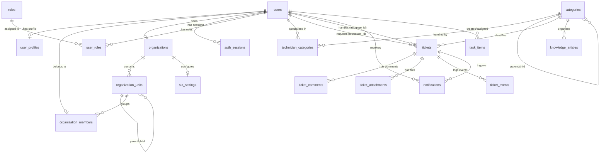

# Thiết kế Cơ sở Dữ liệu (Database Design) — Trạm Mèo

> **Hệ quản trị:** MySQL 8.4 (`utf8mb4`) · **Nguồn đối chiếu 1-1:** `local/src/backend/prisma/schema.prisma` và các bản migration trong `local/src/backend/prisma/migrations/`.
> Tổng số bảng hiện có: **21 bảng**.

---

## 1. Sơ đồ Thực thể Liên kết (ERD)

---

## 2. Từ điển Dữ liệu (Data Dictionary)

### 2.1. Nhóm Tài khoản, Tổ chức & Phân quyền (IAM / RBAC)

#### Bảng `users` — Tài khoản người dùng
| Cột | Kiểu dữ liệu | Ràng buộc | Mô tả |
| :--- | :--- | :--- | :--- |
| `id` | `BIGINT UNSIGNED` | PK, `AUTO_INCREMENT` | Khóa chính người dùng |
| `email` | `VARCHAR(254)` | `UNIQUE`, `NOT NULL` | Email đăng nhập (lowercase) |
| `password_hash` | `VARCHAR(255)` | `NULL` | Mật khẩu băm `bcryptjs` (`NULL` khi chờ kích hoạt) |
| `activation_token_hash` | `CHAR(64)` | `UNIQUE` (`uq_users_activation_token_hash`) | SHA-256 của token kích hoạt |
| `activation_expires_at` | `DATETIME(3)` | `NULL` | Hạn token kích hoạt (24 giờ) |
| `full_name` | `VARCHAR(150)` | `NOT NULL` | Họ và tên hiển thị |
| `phone` | `VARCHAR(30)` | `NULL` | Số điện thoại |
| `is_active` | `BOOLEAN` | `DEFAULT true` | Trạng thái khóa/mở tài khoản |
| `created_at` | `DATETIME(3)` | `NOT NULL` | Thời điểm tạo (UTC) |
| `updated_at` | `DATETIME(3)` | `NOT NULL` | Thời điểm cập nhật (UTC) |

#### Bảng `user_profiles` — Hồ sơ chi tiết & Ảnh đại diện
| Cột | Kiểu dữ liệu | Ràng buộc | Mô tả |
| :--- | :--- | :--- | :--- |
| `user_id` | `BIGINT UNSIGNED` | PK, FK → `users.id` | Khóa chính & khóa ngoại |
| `details` | `JSON` | `NOT NULL` | Chứa `department`, `jobTitle`, `location`, `birthDate`, `bio` |
| `avatar` | `MEDIUMBLOB` | `NULL` | Dữ liệu nhị phân ảnh đại diện (tối đa 2 MB) |
| `avatar_mime` | `VARCHAR(32)` | `NULL` | MIME type (`image/png`, `image/jpeg`, `image/webp`) |

#### Bảng `organizations` — Thông tin tổ chức
| Cột | Kiểu dữ liệu | Ràng buộc | Mô tả |
| :--- | :--- | :--- | :--- |
| `id` | `TINYINT UNSIGNED` | PK | Mã tổ chức (hiện dùng đơn-tenant `id = 1`) |
| `name` | `VARCHAR(150)` | `NOT NULL` | Tên tổ chức |
| `code` | `VARCHAR(30)` | `UNIQUE`, `NOT NULL` | Mã định danh tổ chức |
| `description` | `VARCHAR(1000)` | `DEFAULT ""` | Mô tả tổ chức |
| `owner_id` | `BIGINT UNSIGNED` | `UNIQUE`, FK → `users.id` | Chủ sở hữu tổ chức (`OWNER`) |
| `created_at` | `DATETIME(3)` | `NOT NULL` | Ngày tạo |

#### Bảng `organization_units` — Cơ cấu đơn vị phân cấp (Cây)
| Cột | Kiểu dữ liệu | Ràng buộc / Index | Mô tả |
| :--- | :--- | :--- | :--- |
| `id` | `BIGINT UNSIGNED` | PK, `AUTO_INCREMENT` | Khóa chính đơn vị |
| `organization_id` | `TINYINT UNSIGNED` | FK → `organizations.id` | Tổ chức sở hữu |
| `parent_id` | `BIGINT UNSIGNED` | FK → `(organization_id, id)` | Đơn vị cha (`NULL` nếu là gốc) |
| `code` | `VARCHAR(30)` | `UNIQUE(organization_id, code)` | Mã đơn vị (VD: `HA-TANG`) |
| `name` | `VARCHAR(100)` | `NOT NULL` | Tên đơn vị |
| `is_active` | `BOOLEAN` | `DEFAULT true` | Trạng thái hoạt động |
| `deleted_at` | `DATETIME(3)` | `NULL` | Thời điểm xóa mềm |
* **Indexes:** `uq_org_units_code`, `uq_org_units_id(organization_id, id)`, `idx_org_units_parent(organization_id, parent_id)`.

#### Bảng `organization_members` — Thành viên tổ chức & Vai trò
| Cột | Kiểu dữ liệu | Ràng buộc / Index | Mô tả |
| :--- | :--- | :--- | :--- |
| `user_id` | `BIGINT UNSIGNED` | PK, FK → `users.id` | Người dùng |
| `organization_id` | `TINYINT UNSIGNED` | FK → `organizations.id` | Tổ chức |
| `employee_code` | `VARCHAR(40)` | `UNIQUE(organization_id, employee_code)` | Mã nhân viên |
| `department` | `VARCHAR(100)` | `DEFAULT ""` | Tên phòng ban (fallback nếu chưa gắn `unit_id`) |
| `unit_id` | `BIGINT UNSIGNED` | FK → `(organization_id, unit_id)` | Đơn vị trực thuộc |
| `position` | `VARCHAR(100)` | `DEFAULT ""` | Chức vụ |
| `customer_tier` | `ENUM('STANDARD','VIP')` | `DEFAULT 'STANDARD'` | Nhóm khách hàng áp dụng SLA |
| `role` | `ENUM('OWNER','ADMIN','TECHNICIAN','USER')` | `NOT NULL` | Vai trò chính trong tổ chức |
| `joined_at` | `DATETIME(3)` | `NOT NULL` | Thời điểm gia nhập |
* **Indexes:** `idx_members_org_role(organization_id, role)`, `idx_members_unit(organization_id, unit_id)`.

#### Bảng `auth_sessions` — Phiên đăng nhập & Refresh Token
| Cột | Kiểu dữ liệu | Ràng buộc / Index | Mô tả |
| :--- | :--- | :--- | :--- |
| `id` | `BIGINT UNSIGNED` | PK, `AUTO_INCREMENT` | Session ID (`sid` trong JWT) |
| `user_id` | `BIGINT UNSIGNED` | FK → `users.id` | Chủ phiên |
| `refresh_token_hash` | `CHAR(64)` | `UNIQUE`, `NOT NULL` | SHA-256 của refresh token |
| `expires_at` | `DATETIME(3)` | `NOT NULL` | Hạn phiên (`REFRESH_TOKEN_DAYS`) |
| `revoked_at` | `DATETIME(3)` | `NULL` | Thời điểm thu hồi phiên |
| `created_at` / `updated_at` | `DATETIME(3)` | `NOT NULL` | Dấu thời gian |
* **Index:** `idx_auth_sessions_user_revoked(user_id, revoked_at)`.

#### Bảng `roles` & `user_roles` — Bảng vai trò bổ trợ
* `roles`: `id` (`BIGINT UNSIGNED` PK), `code` (`VARCHAR(30)` `UNIQUE`), `name` (`VARCHAR(100)`).
* `user_roles`: PK `(user_id, role_id)`, `created_at`, Index `idx_user_roles_role_user(role_id, user_id)`. *(Lưu ý: Luồng IAM hiện hành ưu tiên đọc `organization_members.role`; `roles`/`user_roles` được giữ tương thích từ migration khởi tạo).*

---

### 2.2. Nhóm Danh mục, SLA & Quy trình Ticket

#### Bảng `categories` — Danh mục dịch vụ (Cha–Con)
| Cột | Kiểu dữ liệu | Ràng buộc / Index | Mô tả |
| :--- | :--- | :--- | :--- |
| `id` | `BIGINT UNSIGNED` | PK, `AUTO_INCREMENT` | Mã danh mục |
| `code` | `VARCHAR(30)` | `UNIQUE`, `NOT NULL` | Mã loại phiếu (`[A-Z0-9_]+`) |
| `name` | `VARCHAR(100)` | `NOT NULL` | Tên danh mục |
| `parent_id` | `BIGINT UNSIGNED` | FK → `categories.id` (`ON DELETE SET NULL`) | Danh mục cha |
| `is_active` | `BOOLEAN` | `DEFAULT true` | Trạng thái hiển thị |
| `created_at` / `updated_at` | `DATETIME(3)` | `NOT NULL` | Dấu thời gian |
* **Index:** `idx_categories_parent(parent_id)`.

#### Bảng `technician_categories` — Chuyên môn Kỹ thuật viên
* PK `(user_id, category_id)` (FK → `users.id`, `categories.id`), `created_at` (`DATETIME(3)`). Index: `idx_technician_categories_category_user(category_id, user_id)`.

#### Bảng `sla_settings` — Cấu hình Chính sách SLA
* `organization_id` (`TINYINT UNSIGNED` PK, FK → `organizations.id`), `policy` (`JSON` chứa `enabled`, `week`, `holidays`, `rules.STANDARD`, `rules.VIP`).

#### Bảng `ticket_number_rules` — Quy tắc đánh số phiếu
* `category_id` (`BIGINT UNSIGNED` PK — `0` là quy tắc chung mặc định), `prefix` (`VARCHAR(12)`), `next_number` (`INT UNSIGNED`), `digits` (`TINYINT UNSIGNED`), `suffix` (`VARCHAR(12)`).

#### Bảng `tickets` — Yêu cầu hỗ trợ (Trung tâm)
| Cột | Kiểu dữ liệu | Ràng buộc / Index | Mô tả |
| :--- | :--- | :--- | :--- |
| `id` | `BIGINT UNSIGNED` | PK, `AUTO_INCREMENT` | Khóa chính |
| `display_code` | `VARCHAR(40)` | `UNIQUE` (`uq_tickets_display_code`) | Mã phiếu hiển thị (VD: `PYCM00001`) |
| `requester_id` | `BIGINT UNSIGNED` | FK → `users.id` | Người gửi |
| `assignee_id` | `BIGINT UNSIGNED` | `NULL`, FK → `users.id` | Kỹ thuật viên phụ trách |
| `category_id` | `BIGINT UNSIGNED` | FK → `categories.id` | Loại phiếu |
| `title` | `VARCHAR(200)` | `NOT NULL` | Tiêu đề |
| `description` | `TEXT` | `NOT NULL` | Mô tả chi tiết |
| `priority` | `VARCHAR(10)` | `NOT NULL` | `LOW`, `MEDIUM`, `HIGH`, `URGENT` |
| `status` | `VARCHAR(20)` | `NOT NULL` | `NEW`, `IN_PROGRESS`, `PENDING_CUSTOMER`, `RESOLVED`, `CLOSED` |
| `version` | `INT UNSIGNED` | `DEFAULT 1` | Khóa lạc quan (Optimistic Lock) |
| `response_due_at` / `resolution_due_at` | `DATETIME(3)` | `NULL` | Hạn phản hồi / xử lý SLA (UTC) |
| `first_response_at` | `DATETIME(3)` | `NULL` | Mốc phản hồi công khai đầu tiên |
| `response_warning_due_at` / `resolution_warning_due_at` | `DATETIME(3)` | `NULL` | Đánh dấu đã gửi cảnh báo sắp quá hạn |
| `resolved_at` / `closed_at` / `archived_at` | `DATETIME(3)` | `NULL` | Mốc hoàn tất / đóng / xóa mềm |
| `created_at` / `updated_at` | `DATETIME(3)` | `NOT NULL` | Dấu thời gian |
* **Indexes:** `idx_tickets_requester_created`, `idx_tickets_assignee_status_created`, `idx_tickets_status_created`, `idx_tickets_response_due`, `idx_tickets_resolution_due`, `idx_tickets_category_created`.

#### Bảng `ticket_comments`, `ticket_attachments`, `ticket_events`
* **`ticket_comments`:** `id`, `ticket_id` (FK), `author_id` (FK), `body` (`TEXT`), `is_internal` (`BOOLEAN`), `created_at`. Index: `idx_ticket_comments_ticket_created(ticket_id, created_at, id)`.
* **`ticket_attachments`:** `id`, `ticket_id` (FK), `uploader_id` (FK), `original_name` (`VARCHAR(255)`), `storage_key` (`VARCHAR(255)` `UNIQUE`), `archived_at`, `mime_type` (`VARCHAR(100)`), `size_bytes` (`BIGINT UNSIGNED`), `created_at`. Index: `idx_ticket_attachments_ticket_created`.
* **`ticket_events`:** `id`, `ticket_id` (FK), `actor_id` (FK), `event_type` (`VARCHAR(30)`: `CREATED`, `STATUS_CHANGED`, `ASSIGNEE_CHANGED`, `CATEGORY_CHANGED`, `PRIORITY_CHANGED`, `MERGED_INTO`, `MERGED_TICKET`), `old_value` (`JSON`), `new_value` (`JSON`), `note` (`TEXT`), `created_at`. Index: `idx_ticket_events_ticket_created`.

---

### 2.3. Nhóm Cơ sở Tri thức, Thông báo, Mail & Nhiệm vụ

* **`knowledge_articles`:** `id`, `category_id` (FK → `categories.id`, `ON DELETE SET NULL`), `title` (`VARCHAR(200)`), `body` (`TEXT`), `visibility` (`ENUM('PUBLIC','INTERNAL')`), `updated_at`, `archived_at`. Indexes: `idx_kb_category`, `FULLTEXT ft_kb_content(title, body)`.
* **`notifications`:** `id`, `user_id` (FK), `ticket_id` (FK, `NULL`), `type` (`VARCHAR(30)`), `title` (`VARCHAR(200)`), `body` (`VARCHAR(500)`), `read_at`, `created_at`. Index: `idx_notifications_user_read_created(user_id, read_at, created_at, id)`.
* **`ticket_status_mail`:** `id`, `ticket_id`, `ticket_code` (`VARCHAR(40)`), `user_id`, `ticket_status` (`VARCHAR(20)`), `attempts` (`SMALLINT UNSIGNED`), `available_at`, `sent_at`, `failed_at`. Index: `idx_ticket_status_mail_ready(sent_at, failed_at, available_at, id)`.
* **`inbound_ticket_mail`:** `fingerprint` (`CHAR(64)` PK), `ticket_id` (`BIGINT UNSIGNED` `NULL`), `created_at`.
* **`task_items`:** `id`, `title` (`VARCHAR(160)`), `description` (`TEXT`), `status` (`VARCHAR(10)`: `TODO`, `DOING`, `DONE`), `due_date` (`DATE`), `assignee_id` (FK → `users.id`), `created_by` (FK → `users.id`), `version` (`INT UNSIGNED` `DEFAULT 1`). Indexes: `task_items_assignee_idx`, `task_items_creator_idx`.
