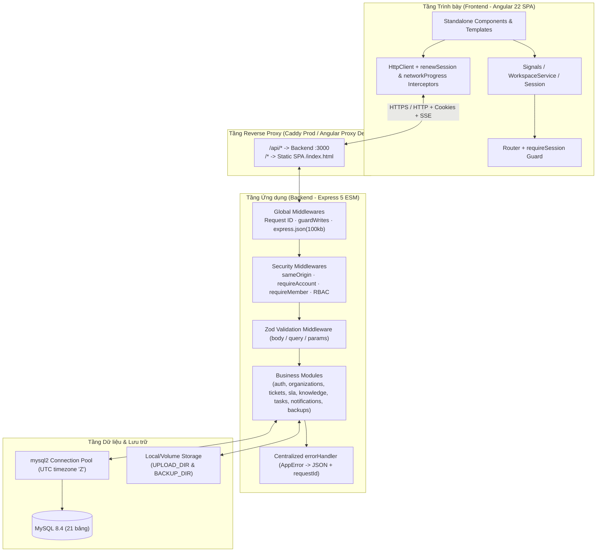

# Kiến trúc Hệ thống (System Architecture) — Trạm Mèo

> **Nguồn đối chiếu:** `local/src/backend/src/app.js`, `local/src/backend/src/server.js`, `local/src/frontend/src/app/app.config.ts`, `local/docker/compose.prod.yaml`, `local/docker/Caddyfile`.

---

## 1. Kiến trúc Phân tầng Tổng thể

Hệ thống áp dụng kiến trúc **Client–Server tách biệt** (Angular SPA + Express REST API) giao tiếp qua cùng origin (Proxy trong Dev, Caddy Reverse Proxy trong Production) để đảm bảo cookie `SameSite=Strict` hoạt động an toàn.

---

## 2. Chi tiết Từng Tầng

### 2.1. Tầng Frontend (Angular 22 SPA)
* **Standalone Architecture:** Toàn bộ component dùng Standalone API, không dùng `NgModule`.
* **Quản lý trạng thái:** Kết hợp Angular **Signals** (`signal`, `computed`, `httpResource`) trong `Session`, `I18n`, `Preferences` và `WorkspaceService`.
* **Bảo vệ định tuyến (`requireSession`):** Kiểm tra trạng thái từ `/api/v1/auth/mode` và `/api/v1/auth/me` (tự thử `/api/v1/auth/refresh` nếu nhận `401`). Điều hướng về `/login` nếu chưa đăng nhập, `/pending-assignment` nếu `organizationId === null`, hoặc trang chủ vai trò (`session.home`) nếu thiếu quyền `route.data['access']`.
* **Tự động gia hạn phiên (`renewSession`):** `HttpInterceptorFn` bắt lỗi `401` từ các API `/api/v1/*` (trừ nhóm `/auth/*`), gọi `session.refresh()` (có `shareReplay(1)` chống gọi trùng) rồi phát lại request ban đầu.

### 2.2. Tầng Backend (Express 5 + Node.js ESM)
* **Pipeline xử lý Request (`app.js`):**
  1. Gắn `req.id = randomUUID()` và header `X-Request-Id`.
  2. `guardWrites`: Khóa các request ghi (`POST`, `PUT`, `PATCH`, `DELETE`) khi hệ thống đang thực hiện khôi phục sao lưu (`maintenance.js`).
  3. `express.json({ limit: '100kb' })`: Giới hạn kích thước JSON body (trừ route `POST /api/v1/mail/inbound` dùng `express.raw` `256kb` và upload multipart qua `multer`).
  4. `sameOrigin`: Chặn các request thay đổi dữ liệu không đến từ `CORS_ORIGIN` hợp lệ.
  5. `requireAccount` → `requireMember` → `requireAdmin` / `requireOwner` (tùy route).
  6. `validate(schema, target)`: Kiểm tra dữ liệu đầu vào bằng **Zod** và gán vào `req.validated`.
* **Cấu trúc Module:** Các module phức tạp (`categories`) tách theo `routes → controller → service → repository`; các module CRUD chuẩn hóa dùng factory `asyncResourceRoutes` (`tickets`, `users`) kết hợp repository thuần SQL tham số hóa (`mysql2`) và transaction (`FOR UPDATE`, `SKIP LOCKED`).
* **Tác vụ nền (`server.js`):** Khi `DATA_SOURCE=mysql`, server khởi chạy vòng lặp `15,000 ms` (có cờ `running` chống chồng chéo và `runBackgroundWrite` phối hợp với cơ chế bảo trì):
  * `warnUpcomingSla`: Quét tối đa 50 ticket/lượt sắp đến hạn SLA trong vòng 30 phút (`FOR UPDATE SKIP LOCKED`) để tạo thông báo.
  * `deliverStatusMail`: Đọc hàng đợi `ticket_status_mail` để gửi email thông báo trạng thái qua SMTP.

### 2.3. Giao tiếp Thời gian thực & Polling
* **Server-Sent Events (SSE):** `GET /api/v1/notifications/stream` giữ kết nối `text/event-stream` (tối đa 8 kết nối/user, heartbeat mỗi 25s, tự đóng nếu tài khoản bị khóa hoặc đổi tổ chức). Khi có ticket/comment/SLA mới trong transaction thành công (`publishNotifications`), backend phát sự kiện `event: inbox\ndata: refresh` để frontend tải lại danh sách thông báo và hiển thị toast.
* **Cơ chế Polling / Tải theo sự kiện:**
  * Lịch sao lưu tự động trên trình duyệt Owner kiểm tra định kỳ mỗi 30 giây (`backup-scheduler.ts` gọi `POST /api/v1/backups/schedule/check`).
  * Live Chat trong ticket tải lại danh sách bình luận khi mở phiếu, sau khi gửi bình luận hoặc khi nhận tín hiệu làm mới.

---

## 3. Chiến lược Bảo mật & Xử lý Lỗi

### 3.1. Bảo mật
| Lớp bảo vệ | Cơ chế triển khai thực tế trong mã nguồn |
| :--- | :--- |
| **Xác thực JWT & Session** | Access Token JWT (`HS256`, `15m`, chứa `sid` & `sub`) + Refresh Token (`64 hex` băm `SHA-256` lưu `auth_sessions` với **token rotation**). |
| **Cookie & CSRF** | Cookie `tram_meo_access` (`path: /api/v1`) và `tram_meo_refresh` (`path: /api/v1/auth`) đặt `HttpOnly`, `SameSite=Strict`, `Secure` (Production). Kết hợp middleware `sameOrigin` kiểm tra header `Origin`. |
| **Mật khẩu & Token** | Bắt buộc mật khẩu mới ≥ 12 ký tự (≤ 72 byte), băm `bcryptjs` (cost 12). Chống timing attack khi đăng nhập bằng dummy hash và `timingSafeEqual` cho inbound mail token. |
| **Rate Limiting** | Giới hạn theo IP & thao tác trong bộ nhớ (`checkRate` trong `auth.routes.js`): `register` (10/15p), `activate` (15/15p), `login` (30/15p), trả `429` + `Retry-After`. |
| **Tệp tải lên** | Kiểm tra `magic bytes` thực tế (`fileType()` trong `attachments.js`), đối chiếu MIME type, giới hạn số lượng/dung lượng, trả `X-Content-Type-Options: nosniff` khi tải xuống. |
| **Chống SQL Injection** | 100% truy vấn `mysql2` dùng prepared statements (`?`), whitelist cột sắp xếp (`sortMap`), escape ký tự đặc biệt `%`, `_`, `!` khi tìm `LIKE`. |
| **Cache Control** | Toàn bộ API trả `Cache-Control: no-store` (hoặc `private, no-store` cho KB) để tránh cache dữ liệu nhạy cảm. |

### 3.2. Chuẩn hóa Xử lý Lỗi (`middlewares/error.js` & `shared/errors.js`)
* Mọi lỗi nghiệp vụ ném ra dưới dạng `new AppError(status, code, message, details)`.
* Express 5 tự động chuyển tiếp lỗi từ async handler tới `errorHandler`.
* Lỗi JSON sai cú pháp (`SyntaxError`) được ánh xạ thành `400 BAD_REQUEST`.
* Lỗi không xác định trả về `500 INTERNAL_ERROR` kèm `requestId` để truy vết mà không rò rỉ stack trace ra client.
