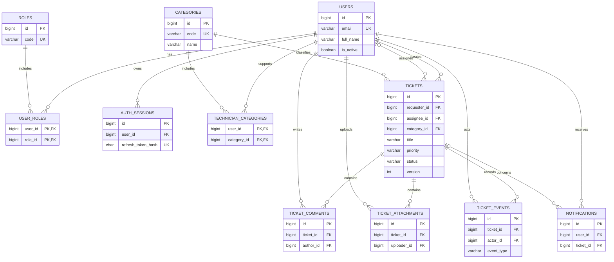

# THIẾT KẾ CƠ SỞ DỮ LIỆU HELPDESK

**Đề tài:** Thiết kế website quản lý yêu cầu hỗ trợ kỹ thuật  
**Trạng thái:** Thiết kế dự kiến; chưa phải cơ sở dữ liệu đã triển khai.  
**Hệ quản trị:** MySQL, bảng InnoDB, bộ mã `utf8mb4`.  
**Tài liệu liên quan:** `API_Helpdesk.md`.

## 1. Phạm vi

Thiết kế phục vụ tài khoản đa vai trò, danh mục, chuyên môn kỹ thuật viên, yêu cầu, phân công, trạng thái, trao đổi, lịch sử và thông báo trong ứng dụng. Email, Zalo và SLA là hướng mở rộng. Sao lưu và phục hồi là quy trình vận hành, không bắt buộc bảng dữ liệu riêng.

## 2. Quy ước

- Tên bảng/cột `snake_case`; khóa chính `id BIGINT UNSIGNED AUTO_INCREMENT`, trừ bảng liên kết dùng khóa chính ghép. Các cột FK dùng cùng kiểu với khóa được tham chiếu.
- Thời gian `DATETIME(3)` lưu UTC; ứng dụng chuyển đổi sang múi giờ người dùng. `created_at`, `updated_at` do server gán và cập nhật.
- `NOT NULL` bắt buộc, `NULL` cho phép rỗng. `PK`: khóa chính; `FK`: khóa ngoại; `UQ`: duy nhất.
- Tài khoản, danh mục và ticket có lịch sử không xóa cứng trong V1; vô hiệu hóa tài khoản/danh mục. Lịch sử giữ nguyên để truy vết.
- Dữ liệu văn bản dùng `utf8mb4`; chọn collation phù hợp phiên bản MySQL được cài và kiểm thử quy tắc so sánh email thực tế. Không lưu mật khẩu thuần, tệp hay token gốc trong DB.

## 3. Sơ đồ ERD Mermaid

Sơ đồ thể hiện cấu trúc logic; các thuộc tính và ràng buộc đầy đủ nằm ở phần 4. Ký hiệu `||--o{` là một-nhiều; `o|` là không hoặc một.

## 4. Từ điển dữ liệu

Tất cả bảng có `id` theo quy ước nếu không ghi khác. Các kiểu độ dài dưới đây là lựa chọn dự kiến, phải được áp dụng nhất quán tại API và migration.

### 4.1 `users` — tài khoản

| Cột | Kiểu / ràng buộc | Ý nghĩa |
|---|---|---|
| id | BIGINT UNSIGNED, PK | Mã người dùng |
| email | VARCHAR(254), NOT NULL, UQ | Email đăng nhập; chuẩn hóa khi tạo |
| password_hash | VARCHAR(255), NOT NULL | Mật khẩu đã băm |
| full_name | VARCHAR(150), NOT NULL | Họ tên |
| phone | VARCHAR(30), NULL | Số điện thoại; không mặc định là duy nhất |
| is_active | BOOLEAN, NOT NULL, DEFAULT 1 | Còn hoạt động |
| created_at, updated_at | DATETIME(3), NOT NULL | Thời gian tạo, cập nhật |

### 4.2 `roles`, `user_roles` — vai trò nhiều-nhiều

| Bảng | Cột | Kiểu / ràng buộc | Ý nghĩa |
|---|---|---|---|
| roles | id | BIGINT UNSIGNED, PK | Mã vai trò |
| roles | code | VARCHAR(30), NOT NULL, UQ | `USER`, `TECHNICIAN`, `ADMIN` |
| roles | name | VARCHAR(100), NOT NULL | Tên hiển thị |
| user_roles | user_id | BIGINT UNSIGNED, PK/FK → users.id | Người dùng |
| user_roles | role_id | BIGINT UNSIGNED, PK/FK → roles.id | Vai trò |
| user_roles | created_at | DATETIME(3), NOT NULL | Thời điểm cấp vai trò |

Khóa ghép `(user_id, role_id)` không cho cấp trùng. API áp dụng hợp quyền và kiểm tra quyền theo từng ticket.

### 4.3 `auth_sessions` — phiên đăng nhập

| Cột | Kiểu / ràng buộc | Ý nghĩa |
|---|---|---|
| id | BIGINT UNSIGNED, PK | Mã phiên |
| user_id | BIGINT UNSIGNED, NOT NULL, FK → users.id | Tài khoản |
| refresh_token_hash | CHAR(64), NOT NULL, UQ | Hash token ngẫu nhiên bằng SHA-256; không lưu token gốc |
| expires_at | DATETIME(3), NOT NULL | Hết hạn |
| revoked_at | DATETIME(3), NULL | Thời điểm thu hồi |
| created_at, updated_at | DATETIME(3), NOT NULL | Thời gian tạo, cập nhật |

Khi refresh, cập nhật hash trong transaction và không chấp nhận lại token cũ. Khi khóa tài khoản hoặc đổi mật khẩu, thu hồi phiên liên quan.

### 4.4 `categories`, `technician_categories` — danh mục và chuyên môn

| Bảng | Cột | Kiểu / ràng buộc | Ý nghĩa |
|---|---|---|---|
| categories | id | BIGINT UNSIGNED, PK | Mã danh mục |
| categories | code | VARCHAR(30), NOT NULL, UQ | Mã ổn định |
| categories | name | VARCHAR(100), NOT NULL | Tên danh mục |
| categories | is_active | BOOLEAN, NOT NULL, DEFAULT 1 | Danh mục hoạt động |
| categories | created_at, updated_at | DATETIME(3), NOT NULL | Thời gian tạo, cập nhật |
| technician_categories | user_id | BIGINT UNSIGNED, PK/FK → users.id | Chuyên viên |
| technician_categories | category_id | BIGINT UNSIGNED, PK/FK → categories.id | Danh mục chuyên môn |
| technician_categories | created_at | DATETIME(3), NOT NULL | Thời điểm thiết lập |

Dữ liệu ban đầu: `SOFTWARE` (phần mềm), `HARDWARE` (phần cứng), `NETWORK` (mạng), `ACCOUNT` (tài khoản). Quan hệ chuyên môn chỉ được cấp cho người có vai trò TECHNICIAN; kiểm tra bằng ứng dụng và transaction khi thay đổi vai trò/chuyên môn.

### 4.5 `tickets` — yêu cầu hỗ trợ

| Cột | Kiểu / ràng buộc | Ý nghĩa |
|---|---|---|
| id | BIGINT UNSIGNED, PK | Mã ticket |
| requester_id | BIGINT UNSIGNED, NOT NULL, FK → users.id | Người tạo |
| assignee_id | BIGINT UNSIGNED, NULL, FK → users.id | Chuyên viên hiện tại |
| category_id | BIGINT UNSIGNED, NOT NULL, FK → categories.id | Danh mục hiện tại |
| title | VARCHAR(200), NOT NULL | Tiêu đề |
| description | TEXT, NOT NULL | Nội dung; API tối đa 10.000 ký tự |
| priority | VARCHAR(10), NOT NULL | `LOW`, `MEDIUM`, `HIGH`, `URGENT` |
| status | VARCHAR(20), NOT NULL | `NEW`, `IN_PROGRESS`, `RESOLVED`, `CLOSED` |
| version | INT UNSIGNED, NOT NULL, DEFAULT 1 | Kiểm soát đồng thời |
| resolved_at | DATETIME(3), NULL | Thời điểm vào RESOLVED gần nhất |
| closed_at | DATETIME(3), NULL | Thời điểm vào CLOSED |
| created_at, updated_at | DATETIME(3), NOT NULL | Thời điểm tạo, cập nhật |

Tạo mới: `NEW`, `MEDIUM`, không phân công. Trạng thái chuyển lại `IN_PROGRESS` từ `RESOLVED` thì xóa `resolved_at`; khi lại `RESOLVED` ghi thời gian mới. `closed_at` chỉ có khi `CLOSED`. Nên bổ sung CHECK cho tập status, priority và version nếu phiên bản MySQL thực thi CHECK; ứng dụng vẫn phải validate.

### 4.6 `ticket_comments` — trao đổi

| Cột | Kiểu / ràng buộc | Ý nghĩa |
|---|---|---|
| id | BIGINT UNSIGNED, PK | Mã bình luận |
| ticket_id | BIGINT UNSIGNED, NOT NULL, FK → tickets.id | Ticket |
| author_id | BIGINT UNSIGNED, NOT NULL, FK → users.id | Người gửi |
| body | TEXT, NOT NULL | Nội dung; API tối đa 10.000 ký tự |
| created_at | DATETIME(3), NOT NULL | Thời gian gửi |

Bình luận hiển thị cho các bên có quyền xem ticket; không có bình luận nội bộ trong V1.

### 4.7 `ticket_attachments` — tệp đính kèm

| Cột | Kiểu / ràng buộc | Ý nghĩa |
|---|---|---|
| id | BIGINT UNSIGNED, PK | Mã tệp |
| ticket_id | BIGINT UNSIGNED, NOT NULL, FK → tickets.id | Ticket |
| uploader_id | BIGINT UNSIGNED, NOT NULL, FK → users.id | Người tải lên |
| original_name | VARCHAR(255), NOT NULL | Tên tệp gốc để hiển thị |
| storage_key | VARCHAR(255), NOT NULL, UQ | Định danh tệp ngẫu nhiên trên nơi lưu trữ riêng |
| mime_type | VARCHAR(100), NOT NULL | Kiểu nội dung đã kiểm tra |
| size_bytes | BIGINT UNSIGNED, NOT NULL | Kích thước byte |
| created_at | DATETIME(3), NOT NULL | Thời gian tải lên |

DB chỉ lưu metadata; cần sao lưu và phục hồi tệp thực cùng CSDL. Không trả trực tiếp đường dẫn lưu nội bộ.

### 4.8 `ticket_events` — lịch sử

| Cột | Kiểu / ràng buộc | Ý nghĩa |
|---|---|---|
| id | BIGINT UNSIGNED, PK | Mã sự kiện |
| ticket_id | BIGINT UNSIGNED, NOT NULL, FK → tickets.id | Ticket |
| actor_id | BIGINT UNSIGNED, NOT NULL, FK → users.id | Tài khoản thực hiện |
| event_type | VARCHAR(30), NOT NULL | `CREATED`, `ASSIGNEE_CHANGED`, `STATUS_CHANGED`, `CATEGORY_CHANGED`, `PRIORITY_CHANGED`, `DETAILS_CHANGED` |
| old_value | JSON, NULL | Giá trị cũ theo cấu trúc sự kiện |
| new_value | JSON, NULL | Giá trị mới theo cấu trúc sự kiện |
| note | TEXT, NULL | Ghi chú khi chuyển trạng thái |
| created_at | DATETIME(3), NOT NULL | Thời gian thực hiện |

Ví dụ thay trạng thái: `old_value={"status":"IN_PROGRESS"}`, `new_value={"status":"RESOLVED"}`. Thay người xử lý: `old_value={"assigneeId":null}`, `new_value={"assigneeId":8}`. Ghi lịch sử mỗi thay đổi; không chỉnh sửa hoặc xóa lịch sử qua API. Nội dung của sự kiện phải được lọc theo quyền xem ticket.

### 4.9 `notifications` — thông báo trong ứng dụng

| Cột | Kiểu / ràng buộc | Ý nghĩa |
|---|---|---|
| id | BIGINT UNSIGNED, PK | Mã thông báo |
| user_id | BIGINT UNSIGNED, NOT NULL, FK → users.id | Người nhận |
| ticket_id | BIGINT UNSIGNED, NULL, FK → tickets.id | Ticket liên quan nếu có |
| type | VARCHAR(30), NOT NULL | `TICKET_CREATED`, `ASSIGNED`, `RESOLVED`, `REOPENED` |
| title | VARCHAR(200), NOT NULL | Tiêu đề |
| body | VARCHAR(500), NOT NULL | Nội dung |
| read_at | DATETIME(3), NULL | NULL nếu chưa đọc |
| created_at | DATETIME(3), NOT NULL | Thời gian tạo |

Một sự kiện có thể tạo nhiều dòng, mỗi dòng cho một người nhận; chỉ chủ thông báo được đọc/đánh dấu. Các quy tắc người nhận mô tả trong tài liệu API.

## 5. Ràng buộc toàn vẹn và nghiệp vụ

1. FK tham chiếu khóa chính, cùng kiểu dữ liệu; đề xuất `ON DELETE RESTRICT`, `ON UPDATE RESTRICT` cho các quan hệ để bảo toàn lịch sử. Các liên kết user_roles/technician_categories được ứng dụng xóa chủ động khi điều chỉnh quyền/chuyên môn; thao tác được ghi nhận theo chính sách quản trị.
2. Email và mã vai trò/danh mục là duy nhất. Email chuẩn hóa nhất quán ở ứng dụng, không dựa vào client. Chỉ cấp vai trò ADMIN thông qua quản trị viên; bảo đảm còn ít nhất một ADMIN hoạt động.
3. `assignee_id` phải là tài khoản hoạt động, có TECHNICIAN và thuộc danh mục tương ứng; FK đơn thuần không đảm bảo các điều kiện này. Thao tác gỡ vai trò, bỏ chuyên môn hoặc khóa người đang phụ trách ticket chưa đóng phải từ chối cho tới khi ADMIN phân công lại.
4. Khi đổi danh mục, nếu người phụ trách hiện tại không thuộc danh mục mới, trả xung đột; chuyển phân công theo quy trình quản trị được áp dụng trước khi thay đổi. Không xóa cứng dữ liệu đã tham chiếu.
5. Lưu thay đổi ticket, sự kiện và các thông báo phát sinh trong cùng transaction. Chỉ cập nhật nếu `WHERE id = ? AND version = ?`; tăng `version` 1 và nếu số dòng cập nhật bằng 0 thì xử lý xung đột hoặc không tồn tại theo quyền truy cập.
6. Không dùng SQL ghép chuỗi từ dữ liệu người dùng; sử dụng tham số và danh sách cho phép với tên cột sắp xếp.

**Đổi danh mục và người phụ trách:** API `PUT /tickets/{id}/classification` cập nhật đồng thời danh mục và chuyên viên, xác minh chuyên môn theo danh mục mới và ghi hai sự kiện trong cùng transaction.

## 6. Chỉ mục đề xuất

| Bảng | Chỉ mục | Phục vụ |
|---|---|---|
| users | UNIQUE(email) | Đăng nhập, tránh trùng |
| roles / categories | UNIQUE(code) | Tra cứu mã |
| user_roles | PK(user_id, role_id); INDEX(role_id, user_id) | Tra quyền theo người dùng/vai trò |
| technician_categories | PK(user_id, category_id); INDEX(category_id, user_id) | Tìm chuyên viên theo danh mục |
| auth_sessions | UNIQUE(refresh_token_hash); INDEX(user_id, revoked_at) | Refresh và thu hồi |
| tickets | INDEX(requester_id, created_at, id) | Danh sách người tạo |
| tickets | INDEX(assignee_id, status, created_at, id) | Danh sách chuyên viên |
| tickets | INDEX(status, created_at, id); INDEX(category_id, created_at, id) | Lọc và thống kê |
| ticket_comments / ticket_events | INDEX(ticket_id, created_at, id) | Trao đổi và lịch sử theo thứ tự |
| ticket_attachments | INDEX(ticket_id, created_at, id); UNIQUE(storage_key) | Tệp theo ticket |
| notifications | INDEX(user_id, read_at, created_at, id) | Thông báo chưa đọc |

Tìm kiếm `LIKE '%từ khóa%'` không mặc định được tăng tốc bởi B-tree thông thường; cân nhắc FULLTEXT sau khi đo và kiểm tra phù hợp với tiếng Việt. Xem kế hoạch truy vấn và điều chỉnh chỉ mục dựa trên dữ liệu thực. MySQL yêu cầu chỉ mục phù hợp cho FK; xem [MySQL 8.4 Foreign Keys](https://dev.mysql.com/doc/refman/8.4/en/create-table-foreign-keys.html).

## 7. Luồng dữ liệu và giao dịch

1. **Tạo:** kiểm tra danh mục hoạt động → tạo ticket `NEW` → ghi `CREATED` → tạo thông báo cho chuyên viên phù hợp, hoặc ADMIN nếu không có → commit.
2. **Phân công:** kiểm tra quyền và chuyên môn → kiểm tra version → cập nhật người phụ trách, tăng version → ghi `ASSIGNEE_CHANGED` → thông báo người mới → commit.
3. **Xử lý:** kiểm tra quyền và chuyển trạng thái hợp lệ → cập nhật trạng thái/thời gian/version → ghi `STATUS_CHANGED` → tạo thông báo cần thiết → commit.
4. **Xác nhận:** người tạo chuyển `RESOLVED` → `CLOSED`, hoặc phản hồi `RESOLVED` → `IN_PROGRESS` kèm ghi chú; ghi lịch sử và thông báo theo API.
5. **Đính kèm:** lưu tệp tạm, kiểm tra, di chuyển vào vùng riêng, ghi metadata; nếu thất bại phải dọn tệp tạm/tệp mồ côi. DB và hệ thống tệp không cùng transaction nên cần cơ chế dọn dẹp định kỳ.

Transaction InnoDB giúp nhóm các thay đổi dữ liệu liên quan; xem [MySQL InnoDB best practices](https://dev.mysql.com/doc/refman/8.4/en/innodb-best-practices.html).

## 8. Sao lưu, phục hồi và kiểm thử

- Sao lưu đồng bộ nhất quán dữ liệu MySQL và kho tệp đính kèm; quản lý phiên bản mã nguồn/bản build, cấu hình triển khai và bí mật theo kênh riêng. Quy định lịch, quyền, mã hóa và thời gian lưu dựa trên môi trường thực tế.
- Phục hồi thử trong môi trường riêng: khôi phục cấu hình, website, CSDL và tệp; kiểm tra đăng nhập, số ticket, lịch sử, thông báo và tải tệp. Không coi sao lưu thành công là đã xác minh khôi phục.
- Kiểm thử FK, email trùng, nhiều vai trò, chuyên môn không hợp lệ, truy cập trái quyền, transaction rollback, xung đột version, toàn bộ nhánh trạng thái và thông báo đúng người.

## 9. Nguồn và giới hạn

Phạm vi chức năng, công nghệ dựa trên `05-de-tai-do-an-co-so-nganh.xlsx`, đề tài 1; cấu trúc tài liệu tham khảo `03-01_MOT_SO_QUY_DINH_CHUNG-2026.pdf` và mẫu báo cáo. Trạng thái chi tiết, bảng và chính sách trong tài liệu là phương án thiết kế, không phải kết quả hiện thực đã xác minh.
