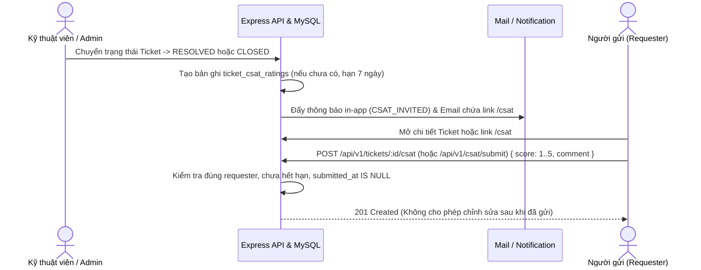

# Kế hoạch Module Khảo sát Chất lượng & Báo cáo Thống kê (CSAT & Analytics)

> **Trạng thái:** `[Draft / Planned]` · **Ngày lập:** 27/11/2026 · **Nhánh:** `local`
>
> **Phạm vi tích hợp:** Mở rộng trang `/reports` (`local/src/frontend/src/app/features/overview/reports.html` & `pages.ts`) và bổ sung module khảo sát CSAT gắn với vòng đời Ticket (`RESOLVED` / `CLOSED`).

---

## 1. Mục tiêu & Phạm vi

1. **Khảo sát mức độ hài lòng (CSAT):** Tự động gửi biểu mẫu/liên kết đánh giá (thang điểm **1–5 sao** kèm nhận xét) ngay sau khi phiếu chuyển sang trạng thái `RESOLVED` hoặc `CLOSED`.
2. **Dashboard phân tích hiệu suất (`/reports`):** Nâng cấp màn hình báo cáo hiện tại (hiện mới đếm trên tập ticket tải về) thành hệ thống tổng hợp truy vấn trực tiếp từ MySQL theo bộ lọc **khoảng thời gian** và **đơn vị/phòng ban (`organization_units`)**:
   * Tỷ lệ tuân thủ cam kết SLA (`% SLA Met vs. Breached`).
   * Thời gian phản hồi trung bình (**Average First Response Time**) và thời gian giải quyết trung bình (**MTTR — Mean Time To Resolution**).
   * Bảng xếp hạng hiệu suất nhân viên dựa trên số lượng ticket đã đóng/hoàn tất và điểm CSAT trung bình.

---

## 2. Thiết kế Cơ sở Dữ liệu Đề xuất (`schema.prisma` / MySQL)

### 2.1. Bảng `ticket_csat_ratings`
| Cột | Kiểu dữ liệu | Ràng buộc | Mô tả |
| :--- | :--- | :--- | :--- |
| `id` | `BIGINT UNSIGNED` | PK, `AUTO_INCREMENT` | Khóa chính |
| `ticket_id` | `BIGINT UNSIGNED` | `UNIQUE`, FK → `tickets.id` | Mỗi phiếu chỉ có 1 bản đánh giá chính thức |
| `requester_id` | `BIGINT UNSIGNED` | FK → `users.id` | Người gửi thực hiện đánh giá |
| `assignee_id` | `BIGINT UNSIGNED` | `NULL`, FK → `users.id` | Kỹ thuật viên được ghi nhận tại thời điểm đánh giá |
| `score` | `TINYINT UNSIGNED` | `NULL` (`CHECK 1..5`) | Điểm hài lòng từ `1` đến `5` sao (`NULL` nếu chưa gửi) |
| `comment` | `VARCHAR(1000)` | `NULL` | Nhận xét chi tiết của người gửi |
| `token_hash` | `CHAR(64)` | `UNIQUE`, `NULL` | SHA-256 token cho liên kết đánh giá qua email (hạn 7 ngày) |
| `expires_at` | `DATETIME(3)` | `NOT NULL` | Thời hạn cho phép đánh giá |
| `submitted_at` | `DATETIME(3)` | `NULL` | Thời điểm hoàn tất đánh giá |
| `created_at` | `DATETIME(3)` | `NOT NULL` | Thời điểm phát hành khảo sát |
* **Indexes:** `idx_csat_assignee_submitted(assignee_id, submitted_at)`, `idx_csat_score(score)`.

---

## 3. Quy tắc Nghiệp vụ CSAT & Công thức Phân tích

### 3.1. Quy trình Gửi & Thu thập Khảo sát CSAT

* **Chống sai lệch dữ liệu:** Nếu phiếu được mở lại (`RESOLVED → IN_PROGRESS`) trước khi người dùng đánh giá, khảo sát cũ chưa gửi sẽ bị hủy hoặc cập nhật `expires_at` mới khi xử lý xong lần tiếp theo. Nhân sự xử lý (`ADMIN`/`TECHNICIAN`) chỉ xem được điểm và nhận xét, không có quyền sửa/xóa bản ghi CSAT.

### 3.2. Công thức Tính Chỉ số Hiệu suất (Backend SQL Aggregation)
Tất cả chỉ số được tính trên tập phiếu chưa xóa mềm (`archived_at IS NULL`), lọc theo `created_at` (hoặc `resolved_at`) trong khoảng thời gian và lọc theo `organization_members.unit_id` (hỗ trợ đệ quy đơn vị con trong `organization_units`):

1. **Tỷ lệ tuân thủ SLA (`% SLA Met vs. Breached`):**
   * Xét các phiếu có cấu hình SLA (`resolution_due_at IS NOT NULL`):
     * **SLA Met:** `(resolved_at IS NOT NULL AND resolved_at <= resolution_due_at)` hoặc `(resolved_at IS NULL AND UTC_TIMESTAMP(3) <= resolution_due_at)`.
     * **SLA Breached:** `(resolved_at > resolution_due_at)` hoặc `(resolved_at IS NULL AND UTC_TIMESTAMP(3) > resolution_due_at)`.
   * Tỷ lệ tuân thủ = $\frac{\text{Số phiếu SLA Met}}{\text{Tổng phiếu có SLA}} \times 100\%$.
2. **Thời gian phản hồi trung bình (Average First Response Time):**
   * Tính trên các phiếu có `first_response_at IS NOT NULL`: trung bình `TIMESTAMPDIFF(MINUTE, created_at, first_response_at)` (có thể bổ sung biến thể trừ giờ ngoài ca theo `sla_settings` ở pha nâng cao).
3. **Thời gian giải quyết trung bình (MTTR — Mean Time To Resolution):**
   * Tính trên các phiếu có `resolved_at IS NOT NULL`: trung bình `TIMESTAMPDIFF(MINUTE, created_at, resolved_at)`.
4. **Bảng xếp hạng Hiệu suất Nhân viên:**
   * Nhóm theo `assignee_id` (`role IN ('TECHNICIAN', 'ADMIN', 'OWNER')`):
     * `closedCount`: Số phiếu đạt `CLOSED` (hoặc `RESOLVED`) trong kỳ.
     * `avgCsat`: `AVG(ticket_csat_ratings.score)` và `csatCount`.
     * `slaComplianceRate`: Tỷ lệ hoàn thành đúng hạn SLA của nhân viên đó.
     * Sắp xếp mặc định theo `avgCsat DESC, closedCount DESC`.

---

## 4. Đặc tả API Đề xuất (`/api/v1`)

| Method | Endpoint | Role / Auth | Mô tả |
| :--- | :--- | :--- | :--- |
| `GET` | `/api/v1/tickets/:id/csat` | Owner/Tech/Admin | Xem trạng thái khảo sát & kết quả đánh giá của phiếu |
| `POST` | `/api/v1/tickets/:id/csat` | `requesterId` | Gửi đánh giá `{ score: 1..5, comment? }` trực tiếp trong phiên đăng nhập |
| `POST` | `/api/v1/csat/submit` | Public (Token) | Gửi đánh giá qua liên kết email `{ token, score, comment? }` |
| `GET` | `/api/v1/analytics/overview` | `ADMIN` | Trả về KPI (`totalTickets`, `slaMet`, `slaBreached`, `avgFirstResponseMinutes`, `mttrMinutes`, `avgCsat`) theo `from`, `to`, `unitId`, `categoryId` |
| `GET` | `/api/v1/analytics/leaderboard` | `ADMIN` | Bảng xếp hạng nhân viên (`closedCount`, `avgCsat`, `csatCount`, `slaComplianceRate`) |

---

## 5. Thiết kế Giao diện Frontend & Kế hoạch Triển khai

* **Khảo sát CSAT (`workspace` & `/csat`):**
  * Khi `requester` mở phiếu ở trạng thái `RESOLVED` hoặc `CLOSED` và chưa đánh giá, hiển thị thẻ đánh giá 1–5 sao ngay phía trên khung chat.
  * Bổ sung route công khai `/csat` để người dùng bấm từ email đánh giá nhanh không cần đăng nhập lại.
* **Dashboard Phân tích (`/reports`):**
  * Bổ sung bộ lọc **Đơn vị / Phòng ban (`unitId`)** và **Khoảng ngày (`from` – `to`)** vào `report-toolbar` trong `reports.html`.
  * Hiển thị 4 thẻ KPI (Tỷ lệ SLA Met, Avg First Response, MTTR, Điểm CSAT TB), biểu đồ cột/donut **SLA Met vs. Breached**, và **Bảng xếp hạng nhân viên** (hỗ trợ xuất CSV).
* **Lộ trình thực hiện:**
  1. **Phase 1 (CSAT):** Tạo migration `ticket_csat_ratings`, tích hợp phát hành khảo sát vào `ticketsMysql.update`, API nộp CSAT và giao diện 5 sao.
  2. **Phase 2 (Analytics Backend & UI):** Xây dựng module `analytics` tổng hợp SQL trên MySQL, nâng cấp `/reports` từ dữ liệu client-side sang API `/api/v1/analytics/*` và viết test tích hợp.
