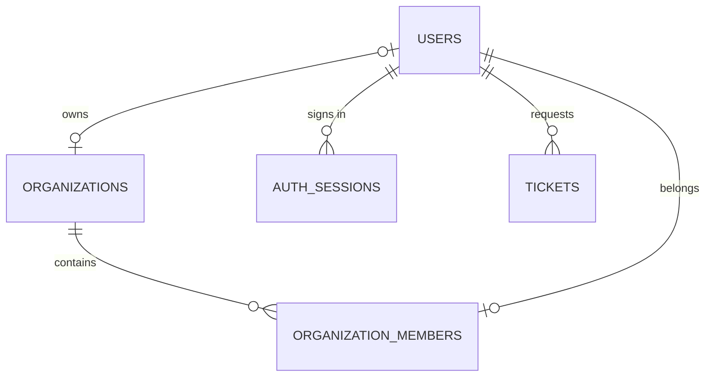

# Định danh, tổ chức và phân quyền

Cập nhật **26/11/2026** · Nhánh `local`

Mỗi bản cài đặt phục vụ một tổ chức. Khóa ngoại liên kết hồ sơ với tài khoản và tổ chức. Ràng buộc MySQL giữ mã nhân viên duy nhất trong tổ chức. Vai trò lấy từ `organization_members` khi đọc phiên. Giao diện phân cấp theo vai trò và hiển thị thành viên ở từng cấp.

| Vai trò | Phạm vi |
| --- | --- |
| OWNER | Cập nhật tổ chức, quy tắc đánh số, sao lưu và khôi phục. Quản lý tài khoản Admin, Chuyên viên và Người dùng. |
| ADMIN | Xem cơ cấu, điều phối phiếu và công việc, quản lý Chuyên viên và Người dùng. |
| TECHNICIAN | Xử lý phiếu được giao, xem tên, phòng và chức danh của người gửi. Dùng không gian người dùng cho các phiếu của mình. |
| USER | Gửi, xem tiến độ, trao đổi và tải tệp trên phiếu của mình. |

| API | Quyền |
| --- | --- |
| `POST /api/v1/auth/register` | Công khai. Tạo tài khoản chưa thuộc tổ chức. |
| `POST /api/v1/auth/activate` | Công khai. Kiểm tra token và hạn dùng khi đặt mật khẩu lần đầu. |
| `GET /api/v1/organizations` | Chủ sở hữu và Quản trị viên đọc thông tin tổ chức. |
| `PUT /api/v1/organizations` | Chủ sở hữu cập nhật tên, mã và mô tả. |
| `GET /api/v1/users` và `GET /api/v1/users/:id` | Chủ sở hữu và Quản trị viên xem nhân sự. Bộ lọc nhận `filter` theo vai trò và `status` theo trạng thái. |
| `POST /api/v1/users` và `PATCH /api/v1/users/:id` | Chủ sở hữu và Quản trị viên quản lý các cấp dưới được phép. |
| `POST /api/v1/users/:id/invitation` | Quản lý cấp trên tạo lại link cho tài khoản đang chờ kích hoạt. |
| `GET /api/v1/users/:id/avatar` và `POST /api/v1/users/:id/avatar` | Đọc trong phạm vi tổ chức. Tải ảnh mới theo quyền quản lý. |

Trạng thái hoạt động được suy ra từ quan hệ thành viên, mật khẩu và cờ khóa. Link kích hoạt dùng token ngẫu nhiên 256 bit, lưu SHA-256 trong MySQL, hết hạn sau 24 giờ và chỉ đổi mật khẩu lần đầu một lần. Cấp link mới làm mất hiệu lực link cũ. Kết nối tài khoản đã tự đăng ký theo email cấp quyền sau lần đăng nhập tiếp theo. Quản trị viên cần xác minh người đăng ký ngoài hệ thống trước khi thêm theo email. Tổ chức dùng link sao chép trên giao diện để gửi riêng cho người được mời.

Migration tự chọn tài khoản quản trị đang hoạt động có ID thấp nhất làm Chủ sở hữu. Các tài khoản còn lại được chuyển sang vai trò tương ứng và giữ nguyên ID liên kết với phiếu. Bản ZIP nghiệp vụ dành cho Chủ sở hữu. Khôi phục ZIP giữ quyền và định danh đang có. [Hướng dẫn máy chủ và tài khoản Chủ sở hữu](../../docker/production.md)

## Kế hoạch mở rộng phòng ban

Trạm Mèo lưu phòng ban và chức danh trong hồ sơ thành viên. Giai đoạn sau mở rộng phạm vi xử lý từ từng kỹ thuật viên sang phòng ban, bổ sung nhóm nghiệp vụ và quyền điều phối theo nhóm.

## Màn hình theo vai trò

| Vai trò | Không gian | Quyền dự kiến |
| --- | --- | --- |
| Requester | Phiếu của tôi, tạo yêu cầu, trao đổi, thông báo, hồ sơ cá nhân | Đọc phiếu do mình gửi, phản hồi công khai, xác nhận kết quả và tải tệp thuộc phiếu |
| Agent | Hàng đợi phòng ban, việc được giao, lịch, nhiệm vụ | Xem phiếu thuộc phòng đang tham gia, cập nhật xử lý khi được giao, ghi chú nội bộ theo quyền |
| Trưởng nhóm | Điều phối, báo cáo phòng và lịch của nhóm | Xem hàng đợi và báo cáo của phòng phụ trách, gán hoặc chuyển việc trong phạm vi phòng |
| Admin | Tổng quan, danh mục tài khoản và phòng ban, phân quyền, sao lưu | Quản lý cấu hình và quyền toàn hệ thống, điều phối trường hợp ngoại lệ, xem nhật ký quản trị |

Khi một Agent mở **Phiếu của tôi**, màn hình lấy phạm vi người gửi từ phiên hiện tại. Backend xác định quyền cho từng yêu cầu dựa trên hành động, tài khoản và tài nguyên. Sidebar và route guard hiển thị lối vào theo quyền tương ứng.

## Thiết kế dữ liệu và định tuyến

- Thêm `departments` với mã, tên và trạng thái, cùng `department_members` với người dùng, phòng và quyền Agent hoặc trưởng nhóm. Ngưng sử dụng giữ nguyên tham chiếu trong lịch sử.
- Thêm `department_id` trên `tickets`, bản ghi phân công và quy tắc mặc định từ loại phiếu tới phòng. Ví dụ Phần cứng → Hỗ trợ Phần cứng, Mạng → Mạng & Hạ tầng, Phần mềm → Phần mềm nghiệp vụ.
- Áp dụng migration theo hai bước. Tạo khóa và trường tùy chọn trước, xác định phòng từ danh mục hoặc người đang phụ trách sau. Phiếu thiếu căn cứ vào hàng đợi cần phân loại. Giữ ID và mã phiếu qua toàn bộ quy trình.
- Lấy phạm vi từ membership đang hoạt động và hành động được cấp. Áp dụng cùng điều kiện cho danh sách, chi tiết, cập nhật, tìm kiếm, thống kê, thông báo, lịch sử và download. Ghi người thực hiện, thời điểm, phạm vi cũ và mới khi đổi quyền hoặc chuyển phòng.

## Phân công và tiêu chí hoàn thành

| Mốc | Người 1 | Người 2 | Nghiệm thu |
| --- | --- | --- | --- |
| IAM-1 · Định danh và tổ chức | Hoàn thành trang tổ chức, nhân sự, đăng ký và kích hoạt | Hoàn thành membership, migration và quyền bốn vai trò | Luồng thêm nhân sự, phân quyền và phạm vi theo phiếu |
| IAM-2 · Định tuyến và điều phối | Danh mục phòng, hàng đợi theo phòng, phân công và phản hồi lỗi | API phòng, gán thành viên, quy tắc định tuyến, policy truy vấn và nhật ký | Phiếu đúng nhóm theo loại, nhân viên ngoài nhóm bị chặn ở bảng và URL chi tiết |
| IAM-3 · Báo cáo và tài nguyên | Báo cáo trưởng nhóm, lịch và kiểm thử trình duyệt desktop/mobile | Áp dụng policy cho tệp, thông báo, báo cáo, truy vấn phân trang và kiểm thử tích hợp | Báo cáo khớp dữ liệu, trưởng nhóm thấy đúng phòng, tệp ngoài phạm vi không tải được |
| IAM-4 · Đưa lên máy chủ | UAT và hướng dẫn tài khoản theo vai trò | Migration staging, TLS, sao lưu ngoài máy, thử khôi phục và rollback | Kiểm tra trên URL công khai, có kết quả UAT và biên bản khôi phục trước khi mở tài khoản thật |

Ca kiểm thử bắt buộc gồm Requester A và B, Agent thuộc hai phòng, trưởng nhóm và Admin. Test thêm tài khoản đa vai trò, đổi phòng trong lúc phiên còn hiệu lực, ngưng phòng và khóa người dùng. Thử trực tiếp qua API cả thao tác hợp lệ và trái quyền.

[Tiến độ hiện hành](../../progress-report/bao-cao-tien-do-local-2026-11-26.md) · [Hướng dẫn production](../../docker/production.md)
