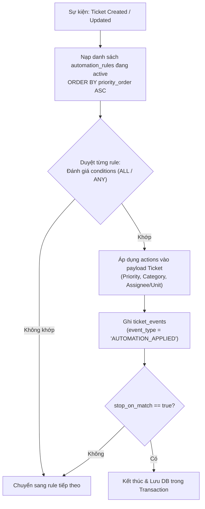

# Kế hoạch Module Tự động hóa & Mẫu phản hồi (Automation & Macros)

> **Trạng thái:** `[Draft / Planned]` · **Ngày lập:** 27/11/2026 · **Nhánh:** `local`
>
> **Phạm vi tích hợp:** Mở rộng trực tiếp trên kiến trúc hiện có (`Express 5 + MySQL 8.4 + Prisma + Zod + Angular 22`).

---

## 1. Mục tiêu & Phạm vi

1. **Mẫu câu trả lời nhanh (Canned Responses / Macros):** Cho phép `ADMIN` / `OWNER` và `TECHNICIAN` lưu sẵn các kịch bản trả lời mẫu kèm biến động (`{{customer_name}}`, `{{ticket_id}}`, `{{ticket_code}}`, `{{category_name}}`, `{{agent_name}}`, `{{sla_resolution_due}}`) để chèn nhanh 1-click vào khung Live Chat của phiếu, tương tự trải nghiệm `KnowledgeLinks` hiện có.
2. **Quy tắc tự động hóa (Trigger / Dispatch Rules):** Cho phép `ADMIN` / `OWNER` cấu hình tập luật tự động đánh giá khi phiếu được tạo (`ON_TICKET_CREATE`) hoặc cập nhật (`ON_TICKET_UPDATE`), ví dụ: *"Nếu tiêu đề chứa từ khóa `Thanh toán` → Tự động gán cho đơn vị `Kế toán` (`unit_id`) / kỹ thuật viên phụ trách và đặt mức ưu tiên `HIGH`."*

---

## 2. Thiết kế Cơ sở Dữ liệu Đề xuất (`schema.prisma` / MySQL)

### 2.1. Bảng `canned_responses` (Mẫu phản hồi nhanh)
| Cột | Kiểu dữ liệu | Ràng buộc | Mô tả |
| :--- | :--- | :--- | :--- |
| `id` | `BIGINT UNSIGNED` | PK, `AUTO_INCREMENT` | Khóa chính |
| `organization_id` | `TINYINT UNSIGNED` | FK → `organizations.id` | Tổ chức sở hữu |
| `category_id` | `BIGINT UNSIGNED` | `NULL`, FK → `categories.id` | Gắn danh mục cụ thể (`NULL` = dùng chung) |
| `owner_id` | `BIGINT UNSIGNED` | `NULL`, FK → `users.id` | `NULL` = mẫu dùng chung toàn đội; có giá trị = mẫu cá nhân |
| `shortcut` | `VARCHAR(40)` | `NULL` | Mã gõ tắt (VD: `/chao`, `/thanhtoan`) |
| `title` | `VARCHAR(150)` | `NOT NULL` | Tên kịch bản hiển thị |
| `body` | `TEXT` | `NOT NULL` | Nội dung mẫu chứa biến `{{...}}` |
| `visibility` | `ENUM('SHARED','PERSONAL')` | `DEFAULT 'SHARED'` | Phạm vi chia sẻ |
| `is_active` | `BOOLEAN` | `DEFAULT true` | Trạng thái bật/tắt |
| `created_at` / `updated_at` | `DATETIME(3)` | `NOT NULL` | Dấu thời gian |
* **Indexes:** `idx_canned_org_active(organization_id, is_active)`, `idx_canned_category(category_id)`.

### 2.2. Bảng `automation_rules` (Luật tự động hóa / Trigger)
| Cột | Kiểu dữ liệu | Ràng buộc | Mô tả |
| :--- | :--- | :--- | :--- |
| `id` | `BIGINT UNSIGNED` | PK, `AUTO_INCREMENT` | Khóa chính |
| `organization_id` | `TINYINT UNSIGNED` | FK → `organizations.id` | Tổ chức |
| `name` | `VARCHAR(150)` | `NOT NULL` | Tên quy tắc (VD: "Điều phối sự cố Thanh toán") |
| `event_trigger` | `ENUM('TICKET_CREATED','TICKET_UPDATED')` | `DEFAULT 'TICKET_CREATED'` | Thời điểm kích hoạt |
| `priority_order` | `INT UNSIGNED` | `DEFAULT 100` | Thứ tự thực thi tăng dần |
| `stop_on_match` | `BOOLEAN` | `DEFAULT true` | Dừng xét các luật sau nếu khớp |
| `conditions` | `JSON` | `NOT NULL` | Mảng điều kiện `{ match: 'ALL' \| 'ANY', items: [{ field, operator, value }] }` |
| `actions` | `JSON` | `NOT NULL` | Hành động `{ setPriority?, setCategoryId?, assignUnitId?, assignUserId?, addMacroCommentId? }` |
| `is_active` | `BOOLEAN` | `DEFAULT true` | Bật/tắt quy tắc |
| `created_by` | `BIGINT UNSIGNED` | FK → `users.id` | Người tạo |
| `created_at` / `updated_at` | `DATETIME(3)` | `NOT NULL` | Dấu thời gian |
* **Index:** `idx_automation_org_event(organization_id, is_active, event_trigger, priority_order)`.

> **Lưu ý tích hợp với `tickets`:** Hiện bảng `tickets` chưa có cột `assigned_unit_id` (vì định tuyến theo phòng ban đang ở `[Draft / Planned]`). Khi triển khai `assignUnitId`, cần bổ sung `assigned_unit_id BIGINT UNSIGNED NULL` (FK → `organization_units`) vào `tickets` hoặc chọn kỹ thuật viên đang hoạt động thuộc `unit_id` đó.

---

## 3. Quy tắc Nghiệp vụ & Cơ chế Thực thi

### 3.1. Render Biến động cho Macros (`Canned Responses`)
* **Danh sách biến hỗ trợ:**
  * `{{customer_name}}`: `requester.fullName`
  * `{{ticket_id}}`: `ticket.id`
  * `{{ticket_code}}`: `ticket.code` (`display_code`)
  * `{{category_name}}`: `category.name`
  * `{{agent_name}}`: `account.fullName` (người đang thao tác)
  * `{{sla_resolution_due}}`: `ticket.resolutionDueAt` định dạng giờ Việt Nam (`UTC+7`)
* **An toàn & Chuẩn hóa:** Render biến bằng hàm thay thế thuần túy (chỉ khớp whitelist key `{{\s*[a-z_]+\s*}}`, không dùng `eval`/template engine thực thi code). Nếu biến không có giá trị, thay bằng chuỗi rỗng hoặc giữ placeholder tùy cấu hình.

### 3.2. Bộ máy Thực thi Trigger (`automation/engine.js`)

* **Toán tử điều kiện hỗ trợ:** `CONTAINS`, `NOT_CONTAINS`, `EQUALS`, `IN` (áp dụng chuẩn hóa tiếng Việt không dấu tương tự `priority.js` khi so khớp từ khóa trên `title`, `description`, `categoryId`, `customerTier`).
* **Chống vòng lặp vô hạn:** Trigger chạy **đồng bộ trong transaction tạo/cập nhật phiếu** và **không tự kích hoạt lại** sự kiện `TICKET_UPDATED` cho thay đổi do chính automation gây ra.
* **Thứ tự ưu tiên với `estimatePriority()`:** Nếu một rule có `setPriority`, giá trị của rule ghi đè kết quả ước lượng từ `priority-rules.json`, đồng thời tính lại `response_due_at` và `resolution_due_at` theo SLA.

---

## 4. Đặc tả API Đề xuất (`/api/v1`)

| Method | Endpoint | Role tối thiểu | Mô tả |
| :--- | :--- | :--- | :--- |
| `GET` | `/api/v1/macros` | `TECHNICIAN` | Lấy danh sách mẫu dùng chung + mẫu cá nhân của actor (lọc `q`, `categoryId`) |
| `POST` | `/api/v1/macros` | `TECHNICIAN` | Tạo mẫu (`TECHNICIAN` chỉ tạo `PERSONAL`; `ADMIN`/`OWNER` tạo được `SHARED`) |
| `PATCH` / `DELETE` | `/api/v1/macros/:id` | `TECHNICIAN` / `ADMIN` | Sửa / xóa mẫu (chỉ chủ sở hữu hoặc `ADMIN`/`OWNER`) |
| `GET` | `/api/v1/settings/automations` | `ADMIN` | Danh sách quy tắc tự động hóa |
| `POST` / `PUT` / `PATCH` | `/api/v1/settings/automations/:id` | `ADMIN` | Tạo, cập nhật điều kiện/hành động, đổi thứ tự hoặc bật/tắt rule |
| `DELETE` | `/api/v1/settings/automations/:id` | `ADMIN` | Xóa quy tắc |

---

## 5. Thiết kế Giao diện Frontend & Kế hoạch Triển khai

* **Tích hợp Live Chat (`workspace.ts`):** Thêm nút **"Mẫu câu"** bên cạnh `KnowledgeLinks` picker; hỗ trợ tìm kiếm hoặc gõ shortcut (VD: `/chao`) để render biến động ngay trên trình duyệt và chèn vào ô bình luận.
* **Trang Quản trị (`settings-nav.ts`):** Thêm mục **Cài đặt → Tự động hóa & Mẫu câu** (`/settings/automations`, `/settings/macros`) với giao diện builder điều kiện (`Nếu [Trường] [Điều kiện] [Giá trị] → Thực hiện [Hành động]`).
* **Lộ trình thực hiện:**
  1. **Phase 1 (DB & Macros):** Tạo Prisma migration cho `canned_responses`, API `/api/v1/macros` và nút chèn 1-click trong `workspace`.
  2. **Phase 2 (Automation Engine):** Tạo bảng `automation_rules`, cài đặt `engine.js` tích hợp vào `ticketsMysql.create` & `update`, bổ sung UI quản trị rule và test tích hợp.
